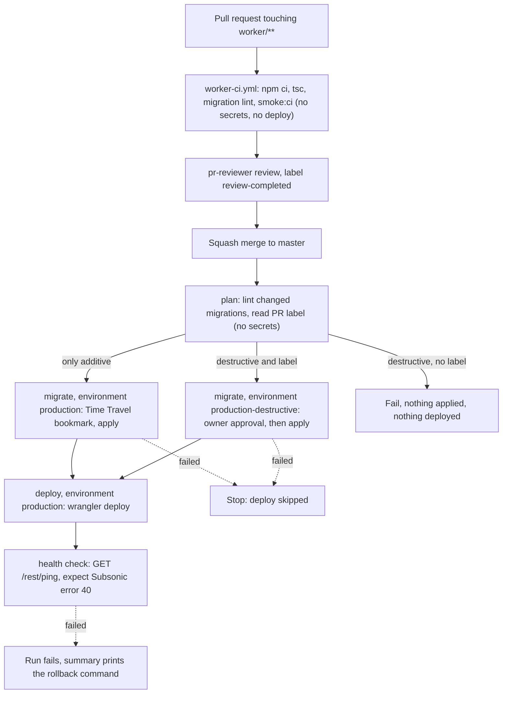

# Worker CI/CD: design

Status: design for the workstream #196 (this doc) -> #199 (owner: token, environments, decisions) -> #197 (CI-safe smoke) and #198 (migration lint) -> #200 (CI workflow) -> #201 (deploy workflow) -> #202 (migrations before deploy) -> #203 (runbook and doc updates). This file is the contract for #197-#203: names, rules and job graph are fixed here. If an implementation ticket finds that something here is wrong, it comments on #196 and the doc is corrected first.

Every claim is tagged:

- **[V]** verified by the author (a repo file, a command output or an official page; the source is named).
- **[R]** not verified (no source found or not testable without production). A later ticket must verify it or accept the risk; the "How to find out" is given where possible.
- **[P]** a proposal (a design decision, not a fact).

Public repo: this doc contains no secret values, no account id, no D1 id and no workers.dev subdomain, and neither may anything derived from it.

## 1. Context and goal

- The Worker (`worker/`) is deployed by hand today: `npx wrangler deploy -c wrangler.local.toml` from `worker/`, with the real D1 id only in the gitignored `worker/wrangler.local.toml` [V CLAUDE.md, docs/architecture.md section 4].
- Migration `0002_library_indexes.sql` had to be applied to production by the owner by hand, because the agents' permission system denies production changes [V #122, ticket text of #196]. The workflow is the sanctioned path from now on; the hand-applied 0002 is the last exception.
- Owner request (2026-10-11): the Worker deploys and D1 migrations apply automatically on merge to master [V #196].
- Owner decision (2026-10-11): a Cloudflare API token may live as a GitHub **environment** secret for the Worker deploy only. The earlier "GitHub is not used for secrets" text was about the removed ingest workflow and stays true for ingest [V #196]. The old `ingest` environment (#75) is unrelated.
- Agents never touch production: agents write and review workflow files, the owner creates the secrets and environments, the run is triggered by the merge [V #196].
- The Worker's own secrets (`TG_BOT_TOKEN`, `SUBSONIC_USER`, `SUBSONIC_PASSWORD`) stay in Cloudflare and are never given to GitHub [V #199]. `worker/wrangler.toml` has no `[vars]`, so a deploy changes none of them [V worker/wrangler.toml]. That deploy preserves existing secrets is the normal Workers behaviour [R]: #201 must state in its PR how it was checked (first real run, then `wrangler secret list` by the owner).

## 2. Pipeline stages

Text form:

| Event | What runs | Secrets | Result |
| --- | --- | --- | --- |
| `pull_request` touching `worker/**` | `worker-ci.yml`: `npm ci`, `npx tsc --noEmit`, migration lint on migrations added or changed by the PR, `smoke:ci` | none | pass/fail check |
| `push` to master touching `worker/**` | `worker-ci.yml` again (cheap, same checks) and `worker-deploy.yml`: `plan` -> `migrate` -> `deploy` (+ health check) | environment secrets only in `migrate` and `deploy` | production updated |
| `workflow_dispatch` on master | `worker-deploy.yml` only (emergency or re-run) | as above | production updated |

Failure behaviour [P]:

- Migration fails -> `deploy` is skipped by `needs:`; the run is red; production keeps the old Worker code (which works with and without the new migration, section 5.1).
- `wrangler d1 migrations apply`: if a migration errors, "this migration will be rolled back, and the previous successful migration will remain applied" [V https://developers.cloudflare.com/d1/wrangler-commands/]. Whether a multi-statement migration file is atomic is not stated on that page [R]. Do not rely on atomicity: that is why the Time Travel bookmark is recorded first.
- Deploy fails -> the migrations stay applied (additive, harmless); fix forward or roll back the Worker (section 9).
- Health check fails -> the run is red and the summary prints the `wrangler rollback` command. No automatic rollback [P]: a rollback is itself a production change and needs a human decision.

File names [P]: `.github/workflows/worker-ci.yml` (display name `Worker CI`, job id `ci`, so the check is `Worker CI / ci`, stable for a future required check) and `.github/workflows/worker-deploy.yml` (display name `Worker deploy`). These are the names the tickets #200 and #201 already use.

## 3. Security model

1. **Token.** One scoped Cloudflare API token, kept ONLY as the GitHub environment secret `CF_DEPLOY_API_TOKEN` in `production` and `production-destructive`. Not a repository secret, not a variable [P, #196/#199]. It is deliberately a different name and a different token from the owner's broad local `CLOUDFLARE_API_TOKEN` in `.env`; inside the single step that runs wrangler it is mapped to `CLOUDFLARE_API_TOKEN`, which is what wrangler reads [V https://developers.cloudflare.com/workers/wrangler/system-environment-variables/].
2. **Environment `production`:** deployment branches limited to `master` [P]. Even a workflow edited on a feature branch cannot obtain its secrets, because the environment refuses the branch. `workflow_dispatch` additionally checks `github.ref == 'refs/heads/master'` in the job `if:` [P].
3. **No `pull_request_target`**, anywhere [P]. Pull request builds get no secrets and no deploy. GitHub does not pass secrets to workflows triggered from forks, except `GITHUB_TOKEN` [V https://docs.github.com/en/actions/how-tos/security-for-github-actions/security-guides/using-secrets-in-github-actions]. The CI workflow references no secret and no `environment:` at all.
4. **Permissions.** Top-level `permissions: contents: read` in both workflows; widened per job only where needed: `pull-requests: read` on the `plan` job (it asks which PR a merge commit belongs to). Nothing gets `write` [P].
5. **Concurrency.** CI: group per workflow and ref, `cancel-in-progress: true` (superseded PR runs are cancelled). Deploy: one group `worker-deploy`, `cancel-in-progress: false`; a running deploy or migration is never cancelled [P]. GitHub keeps at most one pending run per group and replaces an older pending run with a newer one [R]; that is acceptable because the newer run deploys a later master commit that contains the older one. As a guard against an older run executing after a newer one, the `plan` job fails (or no-ops) when `github.sha` is not the current head of master [P].
6. **Logs free of secrets.**
   - Secrets are passed as `env:` of the single step that needs them, never inline in the `run:` text, never as arguments [P].
   - Environment secrets are masked in logs by GitHub; GitHub warns that anything that is not a GitHub secret must be registered with `::add-mask::` before it is printed [V https://docs.github.com/en/actions/how-tos/security-for-github-actions/security-guides/using-secrets-in-github-actions]. Masking replaces the exact string only (and per whitespace-separated word); derived or re-encoded forms are not masked [V https://docs.github.com/en/actions/reference/workflows-and-actions/workflow-commands for add-mask semantics; the "derived form" caveat is [R]]. Therefore: no `set -x`, no `echo` of any id, no `wrangler --verbose`, no `WRANGLER_LOG=debug`, never print the generated config file [P].
   - The job summary (`$GITHUB_STEP_SUMMARY`) also masks secrets automatically [V workflow-commands page], but the design puts only non-secret facts there: git SHA, version id, Time Travel bookmark, names of applied migrations.
   - Not logged by design: token, account id, D1 id, Worker public URL (section 4.3).
7. **No user-controlled text in shell.** Branch names, PR titles and label names never appear inside `run:` via `${{ }}`; they go through `env:` and are used as `"$VAR"`, and decisions are made on the event payload fields (`github.event.pull_request.labels.*.name` compared in an `if:` expression, never interpolated into a script) [P].
8. **Third parties:** only two actions, pinned to full SHAs (section 6). wrangler is run from the lockfile.
9. **Token blast radius** if it leaks: deploy or delete Workers scripts and edit D1 on one account. Mitigations: scope (section 7), revoke and recreate (rotation in #203's runbook), Time Travel (30 days on the paid plan) for the data, `wrangler rollback` for code.
10. **Merge protection is the real gate** for code: anything on master reaches production within minutes. The protection is the PR + independent review flow (decision of 2026-10-10 in CLAUDE.md). See owner decision 1 (section 10).

## 4. Injecting the real ids without writing them to the repo or the log

### 4.1 Facts

- `worker/wrangler.toml` has `database_id = "REPLACE_AFTER_d1_create"`, `database_name = "cowlic"`, `migrations_dir = "migrations"` and no `account_id` [V worker/wrangler.toml]. It stays that way: the placeholder is never replaced in the repo.
- Wrangler reads the account from the environment variable `CLOUDFLARE_ACCOUNT_ID` ("The account ID for the Workers related account") [V https://developers.cloudflare.com/workers/wrangler/system-environment-variables/]. So the account id needs no file at all: it is only an `env:` entry of the wrangler step.
- The D1 id must be inside a config file passed with `--config` (`-c` works in the repo's own commands, e.g. `npx wrangler deploy -c wrangler.local.toml` [V CLAUDE.md]; the Cloudflare commands page documents `--config` generally [V https://developers.cloudflare.com/workers/wrangler/commands/workers/]).
- Wrangler resolves `main` and `migrations_dir` relative to the config file location [R: standard behaviour, not read in the docs here]. Therefore the runner-local config must be written next to `wrangler.toml`, in `worker/`, not in `$RUNNER_TEMP`. #201 confirms it with a dry run (`wrangler deploy --dry-run -c wrangler.ci.toml`, no secrets needed, to be run in the rehearsal) [P].

### 4.2 Exact procedure (one small step, used by `migrate` and `deploy`)

Step "Write runner-local wrangler config" in `worker/`, with `env: D1_DATABASE_ID: ${{ secrets.D1_DATABASE_ID }}` and nothing else from secrets [P]:

1. `echo "::add-mask::$D1_DATABASE_ID"` first, before any other output (belt and braces: environment secrets are already masked, `add-mask` also covers the value in places where GitHub's own detection could miss it) [V add-mask semantics: workflow-commands page].
2. Validate: the value must match the D1 id format (a lowercase UUID: `^[0-9a-f]{8}-[0-9a-f]{4}-[0-9a-f]{4}-[0-9a-f]{4}-[0-9a-f]{12}$`) or the step fails with a generic message that does not echo the value (allowlist, reject invalid, never sanitise) [P; D1 ids being UUIDs is [R], check the format against the owner's secret without printing it: the first run proves it].
3. Substitute the placeholder: preferably a tiny Node one-liner reading `process.env.D1_DATABASE_ID` (no shell expansion of the value inside script text, no `sed` delimiter issues) [P]. It reads `wrangler.toml`, requires that the placeholder occurs exactly once, replaces it, writes `wrangler.ci.toml` with mode 600 [P].
4. Assert the result does not contain the placeholder and print only a fixed text such as `runner-local config written` [P]. Never `cat` the file.
5. Later wrangler steps use `-c wrangler.ci.toml`. The file lives only on the ephemeral runner, is never uploaded (no `upload-artifact` is used anywhere: not in the audit table [P]), never committed. `wrangler.ci.toml` is added to `.gitignore` by #201 so that an accidental `git add` is impossible [P]. `actions/checkout` uses `persist-credentials: false`, so the job has no git credentials to push with anyway [P].
6. The deploy step runs `npx wrangler deploy -c wrangler.ci.toml` with `env: CLOUDFLARE_API_TOKEN: ${{ secrets.CF_DEPLOY_API_TOKEN }}` and `CLOUDFLARE_ACCOUNT_ID: ${{ secrets.CLOUDFLARE_ACCOUNT_ID }}` [P]. The `npm ci` step has NO secrets in its environment, so install scripts of npm dependencies never see the token [P].

How masking is guaranteed, honestly: GitHub masks exact secret values in logs and summaries, and the design adds `::add-mask::` and forbids printing. It is not an absolute guarantee: a program that prints a transformed value (base64, split, URL-encoded) would not be masked [R]. So the design also (a) never prints the value ourselves, (b) uses no verbose wrangler logging, and (c) requires the reviewer to check the first real run's log for the account id, D1 id and workers.dev host (#201 verification step) [P]. Wrangler's normal deploy output lists bindings and, for workers.dev, the public URL [R]; if it printed the D1 id, masking replaces it with `***`.

### 4.3 The Worker's public URL (health check)

The workers.dev subdomain is an account detail and the deploy output prints the URL [R]. #201 says "repository variable, not a literal". Recommendation [P]: store it as a third environment secret `WORKER_URL` (full base URL), not a variable. Variables are plain text and would be printed in a public run log; a secret is masked. Register it with `::add-mask::` too, because the deploy step will print it. This adds one name to the owner ticket #199 (see section 13).

### 4.4 Alternatives considered

- **Commit the real D1 id** (it is not a credential on its own): lost. The repo rule says the real id lives only in the gitignored local file, and a public repo should not publish account infrastructure ids [V CLAUDE.md].
- **Generate the whole config in the workflow with a heredoc:** lost: it duplicates `wrangler.toml` and silently drifts when someone adds a binding or changes `compatibility_date`. The substitution keeps `wrangler.toml` the single source.
- **Pass the id as a wrangler CLI flag or `--var`:** lost: bindings cannot be overridden that way [R], and CLI arguments appear in process listings and are more likely to be echoed.
- **Use an env-substituting config feature in wrangler:** none known for `database_id` in `wrangler.toml` [R]; not relied on.
- **A `D1_DATABASE_ID` repository variable instead of secret:** lost: visible in logs.

## 5. Migration safety rules (spec for #198 lint and #202 migrations job)

### 5.1 Rules

1. **Order: migrate first, deploy second.** Enforced by `needs: migrate` on `deploy` [P].
2. **Code must work with and without the new migration.** The Worker that is live during the window between migrate and deploy is the OLD code on the NEW schema, and a rollback of the Worker leaves the NEW schema under OLD code. So every change is two-step (expand, then later contract). The #122 indexes are the model: queries were correct with or without them [V worker/migrations/0002_library_indexes.sql, header comment]. The PR template or runbook (#203) states this rule.
3. **Only additive and idempotent migrations run unattended:** `CREATE TABLE/INDEX/VIEW/TRIGGER ... IF NOT EXISTS`, `ALTER TABLE ... ADD COLUMN` (additive; not idempotent, flagged as a warning, because D1 tracks applied migrations in `d1_migrations`) [P; `d1_migrations` table V https://developers.cloudflare.com/d1/reference/migrations/].
4. **The lint rejects** (case-insensitive, comments and string literals stripped first, fail closed when unsure): `DROP` of table/index/view/trigger, `ALTER TABLE ... DROP`, `RENAME` (table or column), `DELETE` and `UPDATE` without `WHERE`, `TRUNCATE`-like patterns, `PRAGMA writable_schema` [P, from #198]. Rollback statements inside SQL comments (as in 0002's header) must not trigger it [V 0002 file; #198].
5. **Existing files:** `0001_init.sql` uses `CREATE TABLE` without `IF NOT EXISTS` [V worker/migrations/0001_init.sql] and is already applied; the lint therefore only looks at migrations that are new or pending, never at 0001. `0002` passes.
6. **Destructive migrations** need BOTH the PR label `destructive-migration-approved` AND the manual approval of the owner through the environment `production-destructive` (required reviewer: the owner). Label without approval: nothing runs. Approval without label: the lint fails. The label is a trigger for the route, not an authorisation: anyone with triage rights can add a label, only the environment reviewer can approve [P]. The owner creates the label if missing, through the planner (agents do not change repo settings) [V #200].
7. **Time Travel bookmark before applying**, written to the job summary together with the restore command; if the bookmark cannot be read, the job fails and nothing is applied (fail closed) [P].
8. **A failed migration stops the deploy** (job graph, section 2).
9. **No-op when nothing is pending:** `wrangler d1 migrations list DB --remote` lists unapplied migrations [V https://developers.cloudflare.com/d1/wrangler-commands/]; empty means a green no-op with the summary line "no pending migrations".
10. **Rollback rules** for a migration: either the rollback statements written as comments in the file, run by the owner, or a Time Travel restore (section 9).

### 5.2 Wrangler behaviour used, with verification status

| Command | Claim | Status |
| --- | --- | --- |
| `wrangler d1 migrations apply <DB> --remote` | applies unapplied migrations on the remote DB; asks for confirmation; "The confirmation step will be skipped" in CI, and "a backup will be captured" after applying | [V] flags and text: https://developers.cloudflare.com/d1/wrangler-commands/. The page does not define what counts as "CI" (probably a detected `CI` environment variable, which GitHub Actions sets) [R]: #202 must prove non-interactive behaviour in its first real run, and the job runs with a timeout (`timeout-minutes`) so a hidden prompt cannot hang it [P]. |
| `... migrations apply` default target | which DB is used when neither `--local` nor `--remote` is given | [R] the page does not say. Always pass the flag explicitly [P]. |
| `wrangler d1 migrations list <DB> --remote` | lists unapplied migrations | [V] same page. Output format for scripting [R]. |
| `wrangler d1 time-travel info <DB> [--timestamp] [--json]` | returns a bookmark for the current (or a past) point in time | [V] https://developers.cloudflare.com/d1/reference/time-travel/ and the commands page (`--json` is documented on the commands page, not on the Time Travel page). JSON shape (which field holds the bookmark) [R]: #202 reads it from a rehearsal against a throwaway local or non-production run, or parses defensively and fails closed if the field is missing. Requires Wrangler >= 3.4.0 and a database with `version: production` in `wrangler d1 info` [V time-travel page]; the repo's lockfile pins wrangler 4.149.0 [V worker/package-lock.json]. Whether this call works with the minimal token [R] (section 7). |
| `wrangler d1 time-travel restore <DB> --bookmark=<B>` / `--timestamp=<T>` | overwrites the DB in place; returns a bookmark of the previous state so a restore can be undone; asks `OK to proceed (y/N)` | [V] time-travel page. No documented non-interactive flag [R]; so restore is a manual, interactive owner action, never done by the workflow. Retention: 30 days on Workers Paid, 7 on Free [V]. |
| `wrangler deploy -c <file>` | deploys the Worker with that config | [V] repo usage (CLAUDE.md); `--config` documented https://developers.cloudflare.com/workers/wrangler/commands/workers/. |

## 6. Supply chain: action audit table

Rule [P]: the only third-party actions are `actions/checkout` and `actions/setup-node`, both pinned to a full commit SHA with the version in a trailing comment (`uses: owner/repo@<sha> # vX.Y.Z`). No `cloudflare/wrangler-action`, no cache action, no artifact action, no label or comment bot. The pins were resolved on 2026-10-11 with `gh api repos/<owner>/<repo>/git/ref/tags/<tag>` (both tags are lightweight tags that point directly to a commit, `object.type` = `commit`, so there is no annotated tag to dereference) and the commit dates read with `gh api repos/<owner>/<repo>/commits/<sha>` [V, commands run by the author]. The age rule: at least two weeks old on the day of the audit.

| Action | Version | Full commit SHA | Dates [V] | What it does | Why needed | Audit notes [V from the action's `action.yml` at that SHA] |
| --- | --- | --- | --- | --- | --- | --- |
| `actions/checkout` | v7.0.1 | `3d3c42e5aac5ba805825da76410c181273ba90b1` | commit 2026-07-17, release 2026-07-20 (83+ days) | clones the repo at the event SHA | the workflows need `worker/` | Runs on `node24`. Its `token` input defaults to the job's `GITHUB_TOKEN` and `persist-credentials` defaults to `true` (stores the token in the local git config): set `persist-credentials: false` so no credential stays on disk. It never receives the Cloudflare secrets: they are not in its `env:` and not in its `with:`. Job permission `contents: read` is enough. |
| `actions/setup-node` | v7.0.0 | `820762786026740c76f36085b0efc47a31fe5020` | commit 2026-07-14, release 2026-07-14 (89+ days) | installs a Node version on the runner | wrangler needs Node >= 22 (lockfile: `engines: node >= 22.0.0` for a dependency; [V worker/package-lock.json]) | Runs on `node24`. Downloads Node using the default `github.token` (`token` input default), nothing else. Has a post step for cache saving, so caching is switched off explicitly: `package-manager-cache: false` and no `cache:` input (an automatic cache is only active when `package.json` has a `packageManager` field, which `worker/package.json` has not, but explicit is safer: a shared cache is a poisoning surface for a job holding a deploy token) [P]. |

Version choice notes:

- `actions/setup-node` v7.1.0 exists (2026-10-08) but is 3 days old: excluded by the two-week rule. v7.0.0 is pinned.
- `actions/checkout` v7.0.1 is the newest release; the older majors (v6.1.0, v5.1.0 ...) were re-released the same day as maintenance backports, not relevant.
- Both actions are published by GitHub itself (`actions/` organisation) [V]. The SHAs may also be re-checked by a reviewer: `gh api repos/actions/checkout/git/ref/tags/v7.0.1` must give the SHA above, and `gh api repos/actions/setup-node/git/ref/tags/v7.0.0` the second.
- A pin to a SHA can only be as trustworthy as the maintainers' repository at that commit; the audit notes above cover the action's inputs and token handling, not a line-by-line source review [R: the `dist/` bundles were not reviewed line by line].

**Updating pins** [P]: by hand, one small PR per action ("chore(ci): bump actions/checkout to vX.Y.Z"), re-doing the audit (tag -> SHA, age >= 2 weeks, `action.yml` diff for new inputs or token use) and updating this table in the same PR. No Dependabot auto-merge, no auto-merge bot. The reviewer re-resolves the SHA.

**Why plain `npx wrangler` and not `cloudflare/wrangler-action`** [P, recommendation to confirm in the PR review]:

- wrangler is already a devDependency, and its version is fixed by `worker/package-lock.json` (4.149.0 at the time of writing) [V worker/package.json, worker/package-lock.json]: no new dependency, and the same version runs locally, in CI and in smoke tests.
- The action is one more third party that would receive the deploy token as an input (Cloudflare's own example passes `apiToken` and `accountId` to it [V https://developers.cloudflare.com/workers/ci-cd/external-cicd/github-actions/]) and, as far as that page shows, adds nothing that `npx wrangler deploy` cannot do. Its internal behaviour was not audited [R].
- We need custom steps (runner-local config, Time Travel bookmark, lint gate, health check) that the action does not provide anyway.
- `npm ci` (the lockfile) also runs install scripts of wrangler's dependencies; that step has no secrets in its environment (section 4.2).

## 7. Cloudflare token: minimal permissions

Create a custom token (dashboard -> My Profile -> API Tokens -> Create Custom Token) [V #199 text] with, at account level and only for the one account that owns the Worker and the database:

- Account -> **Workers Scripts -> Edit** [P; permission group exists: https://developers.cloudflare.com/fundamentals/api/reference/permissions/ lists "Workers Scripts Edit" [V]; Cloudflare's CI page says to use the "Edit Cloudflare Workers" template for a Worker deploy [V https://developers.cloudflare.com/workers/ci-cd/external-cicd/github-actions/]. That template contains more than Scripts Edit (it normally includes further Workers and user/account read permissions) [R]; this design does not use the template, it uses the two permissions below and adds only what an observed error demands].
- Account -> **D1 -> Edit** [V group exists: same permissions page]. Needed for `d1 migrations apply/list --remote` and `time-travel info` [R: that these three D1 operations are all covered by D1 Edit alone was not confirmed in docs].
- No zone permissions, no other account, no IP filter (unless the owner wants one: GitHub-hosted runner IPs change, so an IP filter would break the pipeline) [P].

**Possible extra permission [R].** The permissions page lists candidates that wrangler is known to use in some flows: Account Settings: Read, User Details: Read, Memberships: Read (and Workers Tail: Read for `wrangler tail`) [V: they exist on the page; that wrangler needs them for `deploy` is not stated there, [R]]. Reasoning [P]: with `CLOUDFLARE_ACCOUNT_ID` set in the environment, wrangler should not need to list memberships to find the account, so none may be needed. **How to find out:** run the first deploy, or any wrangler step, and read the error: Cloudflare API errors name the failing request or permission (for example an authentication error on a `memberships` or `user` call). The owner adds exactly that one permission, never "all read", and comments which one on #199. A faster check at token creation: run `npx wrangler deploy --dry-run` (needs no token) and then `wrangler whoami` with the token, from the owner's machine, never pasted anywhere [P].

Token hygiene [P]: expiry set to a finite date with a calendar reminder; rotate by creating a new scoped token, updating both environment secrets, then revoking the old one.

## 8. Health check design

- Call: `GET <public worker URL>/rest/ping?f=json` WITHOUT credentials [P]. Without `f=json` the Worker answers XML by default [V worker/scripts/smoke.mjs, "XML response by default" check], so the check sends `f=json` to match a stable JSON body.
- Expected: HTTP 200 and `subsonic-response.status == "failed"` with `error.code == 40` [V worker/src/index.ts: unauthenticated requests get `fail(params, 40, "Wrong username or password")` before any route is reached; the smoke test checks `error.code === 40` for a bad token]. Retry budget about 5 tries with a short sleep (the new version may take seconds to propagate) [P]. The proposal is a small `node` script using `fetch` (no new dependency); the URL comes from the masked `WORKER_URL` (section 4.3) [P].
- **What it proves:** a Worker version is deployed and reachable on the public URL; the script starts without crashing at load; the router and the Subsonic envelope code run; the `/rest/` route exists [V code].
- **What it does NOT prove:** D1 connectivity or that migrations are compatible (`ping` returns before any D1 query: `authenticate` fails first [V worker/src/index.ts]); the Subsonic credentials; Telegram. Worse, error 40 is also what the Worker returns when the Worker secrets are MISSING, because authentication fails closed [V worker/src/auth.ts "Fail closed if secrets are not configured"], so a deploy that lost the secrets would still pass. The credentials are deliberately NOT given to GitHub [V #196, #199], so a deeper check is not possible with `/rest/ping`.
- **Option to decide (not ticketed): a tiny unauthenticated `GET /health`** that runs `SELECT 1` on `DB` and returns `{"ok":true}` [P]. Pros: proves D1 binding and the migrated database answer. Cons: a code change in `worker/src/`, a new unauthenticated surface (it must return no data, no error text, no version), and it still does not prove the secrets. Recommendation: not now; accept the documented limitation, revisit if a migration ever breaks D1 access after a deploy. If chosen, it gets its own ticket and the health step switches to it; the smoke test would also need a case [P].

## 9. Rollback

Order [P]: roll back the Worker first (cheap, instant, reversible), and restore the database only if data or schema is damaged, because a restore also discards every row written after the bookmark (ingest runs on the owner's machine and writes library rows to D1; after a restore re-run ingest; whether ingest is idempotent over lost rows must be checked before relying on it [R]).

### 9.1 Worker

- Find versions: `npx wrangler deployments list` / `npx wrangler versions list` (10 most recent; `--json` available) [V https://developers.cloudflare.com/workers/wrangler/commands/workers/]. The deploy job also writes the version id it deployed and the previous active version id to the summary [P; reading the previous id needs `versions list --json` before the deploy, output shape [R]].
- Roll back: `npx wrangler rollback [<VERSION_ID>] --message "<reason>" -c wrangler.local.toml` from `worker/` on the owner's machine. Without `VERSION_ID` it goes to the version uploaded before the latest; "A rollback will immediately create a new deployment with the specified version" for all routes and domains; with `--message` the interactive prompts are skipped [V commands page]. No `--yes` flag exists [V].
- Limits [V https://developers.cloudflare.com/workers/configuration/versions-and-deployments/rollbacks/]: only the 100 most recent versions; "Resources connected to your Worker will not be changed during a rollback" (so D1 data and schema stay as they are); blocked after Durable Object lifecycle changes or when a target binds a deleted R2/KV/queue (we use none: [V worker/wrangler.toml has only D1]). Whether secrets are kept or reverted is not stated there [R]: after a rollback, check that the Subsonic login still works.
- The rollback is a production change: agents cannot run it from their shell (policy). Owner only, or a future manual `workflow_dispatch` input [P, not planned].

### 9.2 Database

- The bookmark from the job summary (taken before `migrations apply`) is the recovery point. Restore: `npx wrangler d1 time-travel restore cowlic --bookmark=<BOOKMARK> -c wrangler.local.toml` [V syntax https://developers.cloudflare.com/d1/reference/time-travel/]. It "overwrites the database in place", cancels in-flight queries, prompts `OK to proceed (y/N)`, and prints a bookmark of the state before the restore with the command to undo it [V]. A bookmark older than the retention (30 days paid, 7 free) is invalid [V].
- If the summary has no bookmark (it should not happen: fail closed), `time-travel info <DB> --timestamp=<RFC3339>` gives a bookmark for a past time within retention [V].
- For a small additive mistake, the rollback statements kept as comments in the migration file (like 0002's `DROP INDEX IF EXISTS ...`) are cheaper than a restore [V 0002]; they are run by the owner with `wrangler d1 execute cowlic --remote --command ... -c wrangler.local.toml` (flags `--command`, `--file`, `--remote`, `--yes` exist [V https://developers.cloudflare.com/d1/wrangler-commands/]). After running them, the row in `d1_migrations` still marks the migration as applied [R]: write a new migration instead of re-applying.
- Whether `time-travel` works with the minimal token is [R] (section 7). Restore is anyway done locally with the owner's own broad token.

## 10. Owner decisions (the owner confirms them in #199; defaults recommended here)

1. **Approval policy of environment `production`.**
   - Options: (a) no required reviewers, deployment branches restricted to master; (b) the owner as required reviewer (one click per deploy).
   - **Recommended: (a).** The owner wants it automatic. The protection then is: master is only reachable through a PR with independent review (`review-completed`), the branch restriction means no other ref can read the secrets, and migrations that would destroy data wait for approval in any case.
   - Trade-off: anything merged to master reaches production within minutes, including a bad change that review missed; the mitigations are rollback (section 9), Time Travel and the health check. (b) adds a human stop for every deploy, at the cost of one click each time and an owner-availability dependency.
   - Destructive migrations ALWAYS need the owner's manual approval via the second environment `production-destructive`: branches `master`, the owner as required reviewer, the same three secrets. **Recommended and fixed: confirmed as in the ticket.** A note [R]: GitHub's "prevent self-review" option on the environment, if the owner is also the actor, may block the owner's approval; leave it off.
2. **Trigger.**
   - Options: (a) every push to master that changes `worker/**` plus `workflow_dispatch`; (b) only release tags (more control, one extra manual step per release).
   - **Recommended: (a)** [P]. The path filter means docs-only and ingest-only merges do not deploy. The deploy workflow's own file is deliberately not in the filter (a workflow edit alone must not redeploy; the owner can use `workflow_dispatch`). `workflow_dispatch` runs only from master (`if:` on the ref and the environment branch rule).
   - Trade-off of (a): no pause between merge and production; of (b): releases can lag and master and production drift.
3. **Token and secrets on GitHub:** the owner confirms the new rule (section 1) on #199.

## 11. Names

Names only, never values. Final names (used by every later ticket; #199 and #201 follow them):

| Name | Kind | Where | Used by | Notes |
| --- | --- | --- | --- | --- |
| `CF_DEPLOY_API_TOKEN` | environment secret | `production`, `production-destructive` | mapped to `CLOUDFLARE_API_TOKEN` in the wrangler step only | different from the local broad `CLOUDFLARE_API_TOKEN` on purpose |
| `CLOUDFLARE_ACCOUNT_ID` | environment secret | both | wrangler step `env:` (same name wrangler reads) | no file needed |
| `D1_DATABASE_ID` | environment secret | both | runner-local config step | validated, masked |
| `WORKER_URL` | environment secret | `production` | health check | [P] new; see 4.3 and section 13 |
| label `destructive-migration-approved` | PR label | repo | `plan` job, CI gate | created by the planner |
| environments `production`, `production-destructive` | GitHub environments | repo | `migrate`, `deploy` | branch policy `master` |

No repository-level secret with any of these names; the Worker's own secrets (`TG_BOT_TOKEN`, `SUBSONIC_USER`, `SUBSONIC_PASSWORD`) never go to GitHub [V #199].

## 12. Workflow files and job graph

### 12.1 `worker-ci.yml` (#200)

- Triggers: `pull_request` and `push` to master, path filter `worker/**` and the workflow file itself; no `pull_request_target`; no secrets; no `environment:` [V #200].
- `permissions: contents: read`; `concurrency: group: worker-ci-${{ github.ref }}`, `cancel-in-progress: true` [P].
- Job `ci` on `ubuntu-latest`, `timeout-minutes` set [P]; steps: checkout (`persist-credentials: false`), setup-node (22, no cache), then in `worker/`: `npm ci`; `npx tsc --noEmit`; migration lint (#198) on migrations added or changed against the base; the CI-safe smoke command (section 12.3).
- Destructive gate: if the lint reports destructive statements, the job fails unless the PR carries the label `destructive-migration-approved` (read from `github.event.pull_request.labels.*.name` in an `if:`/`env:` boolean, not from text spliced into a script) [P; V #200]. A merged-to-master `push` run re-lints nothing against a base and is only a regression net.

### 12.2 `worker-deploy.yml` (#201, extended by #202)

Triggers: `push` to master with path filter `worker/**` (not docs, not the workflow file itself), and `workflow_dispatch`. `permissions: contents: read`. `concurrency: group: worker-deploy, cancel-in-progress: false`.

| Job | Environment | Secrets | Needs | What it does |
| --- | --- | --- | --- | --- |
| `plan` | none | none; `pull-requests: read` | none | checkout; verify `github.sha` is master head; list migrations changed in `github.event.before..github.sha`; run the lint on them; ask the API which PR the commit came from (`gh api repos/<repo>/commits/<sha>/pulls`, with the default `GITHUB_TOKEN`; mapping a squash-merge commit to its PR with this endpoint is [R]) and whether it has the label; output `environment` = `production` or `production-destructive`, or fail (destructive without label). |
| `migrate` | `${{ needs.plan.outputs.environment }}` | the three env secrets | `plan` | `npm ci` (no secrets); write runner-local config (section 4.2); `migrations list --remote`; if none: summary "no pending migrations", done. Else: re-lint the pending files (defence in depth, fail on destructive unless the job is in `production-destructive` and runs the lint with `--approved`); `time-travel info --json` -> bookmark in summary (fail closed if missing); `migrations apply --remote`; applied names in summary. |
| `deploy` | `production` | the three env secrets (+ `WORKER_URL`) | `migrate` (success) | `npm ci`; runner-local config; record previous version; `npx wrangler deploy -c wrangler.ci.toml`; health check; summary with version id, git SHA and, on health failure, the rollback command. |

Notes:

- A job's `environment:` may be an expression [R; GitHub supports expressions there for job-level `environment`; #202 verifies it on a throwaway run, otherwise falls back to two migrate jobs with `if:`].
- Environment protection (approval) for `production-destructive` is evaluated when the `migrate` job is about to start; the job waits for the owner [V behaviour of required reviewers, general GitHub feature; exact UI [R]].
- `deploy` is not run when `migrate` fails or is skipped by failure (`needs:` default).
- All shell steps pass any non-constant value through `env:`; no `${{ github.event... }}` text inside `run:` [P].

### 12.3 CI-safe smoke (spec for #197)

`worker/scripts/smoke.mjs` today needs a `.dev.vars` file, a seeded local D1 with track `t1`, and real Telegram for the `stream` checks [V worker/scripts/smoke.mjs header and checks]. CI version [P]:

- A switch such as `SMOKE_SKIP_STREAM=1` skips the four checks that fetch from Telegram (Range, full body, content type, MP3 header; plus the full-size check with the hard-coded 7682132 bytes). The checks that do not reach Telegram (auth, library endpoints, stubs, XML, unknown id error) stay. Default behaviour unchanged.
- `.dev.vars` generated per run with FAKE values: `TG_BOT_TOKEN=dummy` and a random `SUBSONIC_USER`/`SUBSONIC_PASSWORD` produced in the job (not a secret, never reused). The file is gitignored [V .gitignore lists `.dev.vars`].
- Schema from the committed migrations: `wrangler d1 migrations apply DB --local` (flags [V d1 commands page]), which also proves that all migrations apply to an empty database; seed rows (`ar1`, `al1`, `t1`, fake Telegram ids) from a committed SQL fixture.
- `package.json` scripts only (no new dependency): `smoke:ci` runs migrations (local), seed, `smoke.mjs` with the skip switch, `paging-check.mjs`; non-zero exit on any failure [V #197].
- With the placeholder `database_id` in `wrangler.toml` local mode may or may not need a real id: the D1 local-development page only talks about `preview_database_id` and does not say whether a placeholder `database_id` is fine [V page read; conclusion [R]]. #197 settles it by running from a clean checkout and states the result; if it does not work, the CI step generates a throwaway local config (a different file from the production one) with a fake id.

## 13. Changes needed in the sibling tickets (listed here as the ticket asks; also posted as comments)

- **#199 (owner):** add a fourth environment secret `WORKER_URL` in `production` (the public Worker base URL; masked) if the owner accepts section 4.3; otherwise #201 uses a variable and the workers.dev host appears in public logs. Also: add "no extra permission is expected; if the first run names one, add exactly that one" (already there).
- **#201:** (a) job `plan` and the `migrate`/`deploy` split come from #202's scope, but `plan` and the guard "sha is master head" are best created in #201 so that #202 only adds the migrate job; (b) `wrangler.ci.toml` goes into `.gitignore`; (c) the health URL is the secret `WORKER_URL`, registered with `::add-mask::`; (d) `wrangler deploy --dry-run -c wrangler.ci.toml` once in the rehearsal to confirm the config location (section 4.1); (e) first-run log scan for the account id, D1 id and workers.dev host.
- **#202:** `migrate` runs in the environment computed by `plan`; `--approved` only in `production-destructive`; non-interactive proof and JSON shape of `time-travel info` are explicit first-run verifications; `timeout-minutes`.
- **#200:** `smoke:ci` name and lint call as in section 12; check name `Worker CI / ci`.
- **#203:** see section 14.

## 14. Doc edits for #203 and the runbook outline

Edits (each statement must be true after the pipeline lands):

- `CLAUDE.md`: the fact "GitHub no longer uses secrets ... none should be added" becomes: ingest uses none; the Worker deploy uses environment secrets in `production` and `production-destructive`; add the layout entries for the workflows, the lint and `smoke:ci`; keep the rule that agents cannot do production changes. (This ticket does NOT edit CLAUDE.md.)
- `README.md`: the paragraph about secrets.
- `docs/architecture.md` section 4: the sentence "GitHub is not used for secrets any more" and the Worker deploy and secrets setup text; the risk table row if it mentions manual deploy. Mention that migration 0002 was applied by hand (#122) and is the last exception.
- `docs/poc-plan.md` only if it contradicts.
- Check: `grep -n "no longer uses secrets\|not used for secrets" CLAUDE.md README.md docs/` returns only true statements [V #203].

Runbook outline (`docs/worker-release.md` or a section here): release flow (PR -> CI -> review -> merge -> plan -> migrate -> deploy -> health), where to read a run and what each summary shows, rollback (section 9), the order of rollbacks, emergency manual deploy (first `workflow_dispatch` on master; last resort the owner's local `npx wrangler deploy -c wrangler.local.toml` from `worker/`; agents cannot do either from their shell), secrets inventory with locations (GitHub environment secrets, Worker secrets in Cloudflare, local `.env` keys) and rotation (create a new scoped token, update both environment secrets, revoke the old), the author rule for migrations (additive and idempotent, code works with and without them, how to request a destructive one with the label plus approval).

## 15. Emergency manual deploy path

1. First choice: Actions -> "Worker deploy" -> Run workflow on master (`workflow_dispatch`), which goes through plan, migrate, deploy and the health check with the same protections [P].
2. If GitHub Actions or the environment secrets are unavailable: the owner runs, from `worker/` on their own machine, `npx wrangler deploy -c wrangler.local.toml` (the existing path with the gitignored config and the owner's own token) [V CLAUDE.md]. Migrations in that case: `npx wrangler d1 migrations apply cowlic --remote -c wrangler.local.toml` after `time-travel info` has been noted by hand [P; commands R per section 5.2].
3. Agents cannot do either (production changes are denied to their shell) [V #122, CLAUDE.md]; they prepare the change and the owner runs it.
4. After a manual deploy: run the health check by hand (`/rest/ping?f=json` without credentials must show error 40), then log in from Symfonium, and file a note on the ticket that the pipeline was bypassed and why.

## 16. Verification status of this document

Verified by the author on 2026-10-11: repo files named above; GitHub API for both action pins and their `action.yml`; the Cloudflare pages cited as [V]. Not verified (all [R] items): wrangler behaviour in CI (non-interactive `d1 migrations apply --remote`, JSON shape of `d1 time-travel info`, behaviour of the token with only the two permissions, `wrangler rollback` effect on secrets), masking of derived values, `commits/{sha}/pulls` for squash merges, the `environment:` expression, config-file-relative path resolution, local-mode `database_id` placeholder. No workflow was run and nothing was applied to production. There are no tests for a docs-only change; the reviewer re-checks the two action SHAs with the `gh api` commands in section 6.
